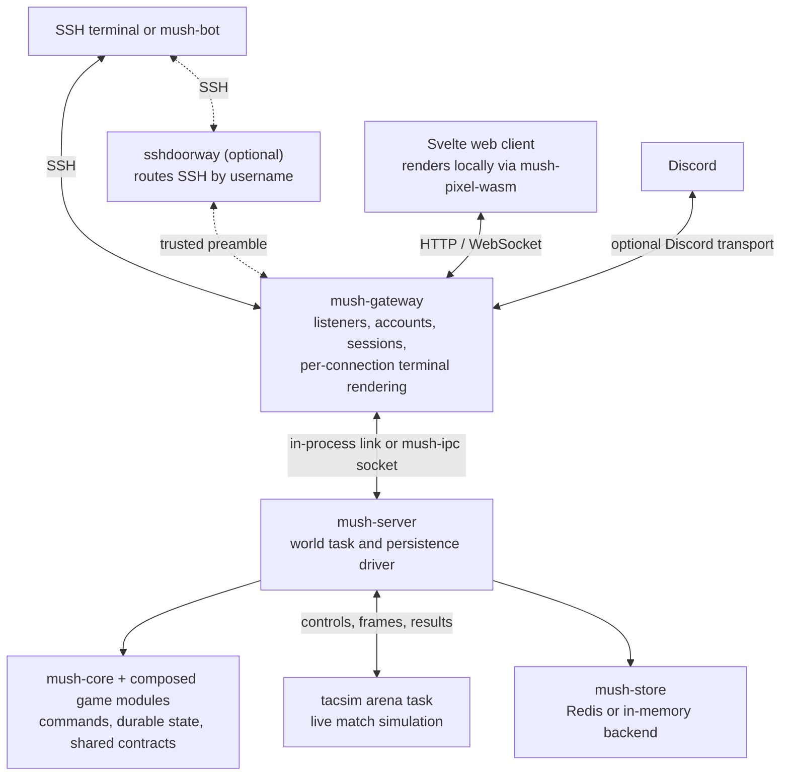

# Crate map

[Project overview](../README.md) · [Documentation](../docs/README.md) · [Design documents](../docs/design/README.md)

The workspace has **52 crates**. RustMUSH supplies the world engine, transports,
persistence, and reusable game systems; **TacSim** supplies the game's pilot
sheets, combat simulation, authored content, and setting-specific rules.
[`mush-composition`](mush-composition/) connects those systems into the running
server.

## How the pieces fit

This is a runtime map, not an exhaustive Cargo dependency graph.
**`mushd` runs the gateway and server together in one process.** In a split
deployment, `mush-gateway` keeps player connections while the independently
managed `mush-server` restarts and recovers. The optional `sshdoorway` service
sits in front of instance gateways and routes SSH players by username.

The world task owns command execution and durable game state. `mush-core` is
synchronous; the server driver handles persistence and asynchronous work.
Live matches run in separate arena tasks around a deterministic simulation
library, with controls, observer frames, journals, and settlement crossing an
explicit world/arena boundary. Both terminal and web interfaces consume the
shared `mush-proto` vocabulary.

**Rendering happens at the edge, not in the world.** `mush-server` emits semantic
output events and observer feeds; it never produces ANSI text or pictures. For
SSH players, the gateway process renders each connection through `mush-net-ssh`:
line-mode text via `mush-ansi`, the ratatui TUI, and cockpit and map pictures
drawn by `mush-pixel` and encoded for the terminal's graphics protocol. The
browser receives the same events and feeds as JSON and draws pictures locally
with `mush-pixel-wasm`. Under `mushd`, the rendering side and the world share one
process, but the division of work is the same.

## Runtime and connections

| Crate | What lives here | How it fits |
| --- | --- | --- |
| [`mushd`](mushd/) | All-in-one executable, in-process glue, offline core REPL. | The simplest server entry point. `--repl` exercises the core command surface without the full game module stack. |
| [`mush-gateway`](mush-gateway/) | Account login, transport bridges, sessions, delivery, connection lifecycle and server reconnection; hosts the SSH, web and Discord transports, so per-connection terminal rendering runs in this process. | Owns live connections and turns the server's semantic output into each client's presentation. In split deployments, the service manager owns server restarts; the gateway retains and reattaches sessions. |
| [`mush-server`](mush-server/) | World task, boot/recovery, persistence driver, deferred work, help and staff operations. | Hosts the authoritative world and communicates with the gateway; it owns no public connection listeners. |
| [`mush-composition`](mush-composition/) | Production module roster, boot ordering, cross-module adapters and TacSim wiring. | The assembly point between reusable systems and the game's modules. |
| [`mush-config`](mush-config/) | TOML configuration, logging, metrics, IP guard and account helpers. | Shared runtime support for both halves and `mushd`. |
| [`mush-ipc`](mush-ipc/) | Gateway/server messages, service requests and replies, link interfaces and framed MessagePack codec. | Defines the process boundary and connection lifecycle protocol. |
| [`mush-session`](mush-session/) | Session attachment, multi-connect delivery, flood control, backpressure and reconnect replay. | Maps character identities to live transports without owning the game world. |
| [`mush-net-ssh`](mush-net-ssh/) | SSH listener, authentication hooks, line editor, terminal capabilities, ANSI output, the full-screen TUI and terminal picture encoding. | Runs inside the gateway process and renders each SSH connection with `mush-ansi` and `mush-pixel`; the world server never renders. |
| [`mush-net-web`](mush-net-web/) | HTTP authentication, WebSocket transport, SPA serving, health and metrics endpoints. | Serves the [web client](../web/README.md) and its structured event stream. |
| [`mush-net-discord`](mush-net-discord/) | Discord event/REST adapters, account-link commands, DM follow/input and bounded output delivery. | An optional transport whose game operations cross gateway hooks. |
| [`mush-sshdoorway`](mush-sshdoorway/) | The `sshdoorway` executable: instance routing, trusted upstream connections, authentication relay and connection limits. | An optional shared SSH front door, separate from instance account and world state. |
| [`mush-sshdoorway-proto`](mush-sshdoorway-proto/) | Versioned trusted-ingress preamble and readiness/authentication messages. | Carries the original peer address and verified key information from doorway to instance. |
| [`mush-drain`](mush-drain/) | Generation draining, session registry, warning deadlines, shared listeners, signals and service-manager notifications. | Shared restart machinery for the gateway and doorway; existing sessions remain with their draining process. |

## Engine and shared contracts

| Crate | What lives here | How it fits |
| --- | --- | --- |
| [`mush-core`](mush-core/) | World/object model, permissions, locks, commands, scheduler, module registry, behaviors, ledgers, mechanical definitions, action transactions and recovery contracts. | The synchronous foundation shared by all game systems; runtime I/O stays outside it. |
| [`mush-proto`](mush-proto/) | Client commands, output events, rich text, panels, capabilities, envelopes and generated TypeScript types. | One semantic vocabulary for game code and client surfaces. |
| [`mush-store`](mush-store/) | Store interface, Redis persistence, atomic batches, durable records, migrations, archive access and in-memory backend. | The server driver's persistence boundary, with real and test implementations. |
| [`mush-ruleset`](mush-ruleset/) | Ruleset interfaces, composable sheet schemas, validated sheet storage, chargen budgets, rendering and NPC grounding. | Reusable character-sheet machinery consumed by TacSim's pilot module. |
| [`mush-dice`](mush-dice/) | Dice-expression parser, per-die results, injectable RNG and pool mechanics. | Roll resolution independent of the world engine. |
| [`mush-content`](mush-content/) | Content-pack format, digests, dependency pins, entry-kind registry and apply/update/retire tracking. | Gives authored content a versioned lifecycle while each consuming module interprets its own entries. |

## Social play and world services

| Crate | What lives here | How it fits |
| --- | --- | --- |
| [`mush-comsys`](mush-comsys/) | Channels, memberships, speaking aliases, history and delivery permissions. | Shared social communication. |
| [`mush-mail`](mush-mail/) | In-game mail, folders, quotas, composition and notifications. | Durable player correspondence. |
| [`mush-jobs`](mush-jobs/) | Staff queues, comments, character notes and structured approval payloads. | Review workflows used by other game systems. |
| [`mush-privileges`](mush-privileges/) | Explicit grants/revocations and a durable privilege audit. | Sensitive capabilities that must be granted deliberately, regardless of staff role. |
| [`mush-script`](mush-script/) | Sandboxed Rhai runtime, typed builder API, object hooks and scripted commands. | Builder-authored world behavior under operation and permission limits. |
| [`mush-weather`](mush-weather/) | Climate data, zone weather, ambience, environmental queries and reviewed flavor drafts. | Shared environmental conditions for rooms and consuming systems. |
| [`mush-scenes`](mush-scenes/) | Durable scenes, timestop turns, scene clocks, event records and recaps. | Coordinates bounded episodes of narrative play and their recovery. |
| [`mush-canon`](mush-canon/) | Append-only consequences, visibility scopes, chronicle queries and superseding retcons. | Records what became true in the world, separately from transcripts. |
| [`mush-party`](mush-party/) | Temporary rosters, leadership and a lock/release lifecycle. | Groups players for an activity without making the party an economic owner. |
| [`mush-faction`](mush-faction/) | Factions, visible/hidden memberships, relationships, territory, resource ratings, fronts and clocks. | Political groups and their activity, linked to organizations for economic ownership. |

## Economy, ownership and production

| Crate | What lives here | How it fits |
| --- | --- | --- |
| [`mush-org`](mush-org/) | Organization identity, scopes, memberships, roles, grants, policies and live authorization. | The ownership and permission layer used by economic systems. |
| [`mush-economy`](mush-economy/) | Instruments, accounts, double-entry journal, asset title, custody, vaults, approvals, contracts and obligations. | Authoritative money and ownership changes, committed as durable transactions. |
| [`mush-inventory`](mush-inventory/) | Quantity pools, lots, locality, lineage and reservation-backed operations. | The shared quantity authority used by industry, markets and simulation. |
| [`mush-industry`](mush-industry/) | Deposits, surveys, claims, extraction, facilities, recipes, work orders, production and refit workflows. | Consumes inventory quantities and economic custody through shared contracts. |
| [`mush-market`](mush-market/) | Catalogs, listings, quotes, vendors, market makers and public projections. | Trading workflows over economy/inventory; game-specific definitions arrive through adapters. |
| [`mush-housing`](mush-housing/) | Properties, tenancies, support assessments, access, guests and explicit tenancy resolution. | Connects homes and resident access to economic obligations. |
| [`mush-campaign`](mush-campaign/) | Declared operations, formations, funded bonds, phase progression and terminal resolution. | Coordinates longer activities against committed resources and records their outcomes. |

These boundaries separate **who can act** (`mush-org`), **who owns value and
assets** (`mush-economy`), **how much material exists** (`mush-inventory`), and
**what work changes it** (`mush-industry`). Markets and campaigns use those
authorities rather than keeping competing balances or stock counts.

## Geography and simulation

| Crate | What lives here | How it fits |
| --- | --- | --- |
| [`mush-atlas`](mush-atlas/) | Regions, neighborhoods, sites, structures, room geometry, portals, terrain, maps and authored place packs. | The spatial description of the world and the terrain consumed by simulation. |
| [`mush-sim`](mush-sim/) | Domains and clocks, nested placement, interiors, mounts, stations, crew control, journeys, custody and relay infrastructure. | Owns placement and shared physical/control relationships. |
| [`mush-tactics`](mush-tactics/) | Tactical units, mobility, sections/components, damage mutations, contacts, sensors, status, custody and observer projections. | Owns generic unit structure and tactical state; concrete combat formulas come from TacSim. |
| [`mush-propagation`](mush-propagation/) | Shared physical context, detection/delivery resolvers, interference, false contacts and delivery envelopes. | Answers what can be observed or delivered; tactics retains contact lifecycle authority. |

`mush-atlas` describes a place, `mush-sim` places a whole object there, and
`mush-tactics` models the object's internal structure and observed contacts.
`mush-propagation` applies the physical conditions that affect sensing and
communication. The [design guide](../docs/design/README.md) explains these
boundaries in more depth.

## TacSim and programmable units

| Crate | What lives here | How it fits |
| --- | --- | --- |
| [`tacsim`](tacsim/) | Pilot sheets; combat arena and match lifecycle; ground/space rules; authored units, weapons and sensors; AI/mind integration; ports, mining, relays and game economy adapters. | The game's rules and content, built on the reusable systems above. |
| [`mush-mind`](mush-mind/) | Deterministic Rhai sandbox, operation/fee budgets, canonical memory and compilation cache. | Executes unit minds. TacSim supplies the view, intent vocabulary and runner. |
| [`mush-roll`](mush-roll/) | Character-owned authoring drafts, immutable revisions, selections, retention and commercial filing records. | The versioned authoring/ownership workflow behind programmable minds; dice live in `mush-dice`. |

Within `tacsim`, [`arena`](tacsim/src/arena/) is the simulation library;
[`arena_task`](tacsim/src/arena_task.rs) hosts a running match;
[`arena_bridge`](tacsim/src/arena_bridge.rs) connects it to the world;
[`match_`](tacsim/src/match_/) manages lifecycle and settlement; and
[`minds`](tacsim/src/minds/) supplies the programmable-unit API.
[`sheet`](tacsim/src/sheet/) owns the pilot sheet.

## Model-assisted play and external agents

| Crate | What lives here | How it fits |
| --- | --- | --- |
| [`mush-llm`](mush-llm/) | Provider adapters, routing, budgets, concurrency limits, retries, audit and test providers. | Asynchronous model service; world mutations remain the consuming module's responsibility. |
| [`mush-worldgen`](mush-worldgen/) | Themes, room/building generation, drafts, review and acceptance. | Builder-reviewed worldbuilding over `mush-llm`. |
| [`mush-npc`](mush-npc/) | Profiles, stimuli, turn planning, typed actions, memory, knowledge and intelligence sharing. | Snapshots context, requests model work, then validates actions back on the world task. |
| [`mush-bot`](mush-bot/) | Standalone SSH player, character/cast tools, scripts, decisions, traces, replay, budgets and regression harnesses. | An external client with its own model and planning stack; its production dependencies do not include the game runtime or `mush-llm`. |

## Presentation and graphics

| Crate | What lives here | How it fits |
| --- | --- | --- |
| [`mush-ansi`](mush-ansi/) | Semantic text rendering, themes, color downgrade and terminal-safe wrapping. | Converts shared output events to SSH text. |
| [`mush-pixel`](mush-pixel/) | Shared picture/frame renderer, cockpit and overhead views, orbital charts, armor diagrams, replays, unit looks and terminal image encoders. | Draws observer feeds for terminal graphics and the browser's rendering engine. |
| [`mush-pixel-wasm`](mush-pixel-wasm/) | WebAssembly exports around the shared picture renderer. | Lets the browser render locally from feeds; built by the web build/test scripts. |

The [Svelte frontend](../web/) is outside the Cargo workspace. It combines
generated protocol types, game panels, editors and the WebAssembly renderer.

## Test support

| Crate | What lives here | How it fits |
| --- | --- | --- |
| [`mush-testkit`](mush-testkit/) | In-process world driver, fixtures, event assertions and persistence helpers. | Exercises real commands and modules without network listeners; also supplies the minimal REPL boot. |
| [`mush-contract-tests`](mush-contract-tests/) | Cross-crate behavioral gates, architectural boundaries, recovery probes and source-policy checks. | Keeps shared contracts consistent across independently developed subsystems. |

Feature tests also live beside their implementations. Runtime integration suites
in [`mushd/tests`](mushd/tests/) and [`mush-server/tests`](mush-server/tests/) cover
boot, transports, recovery and end-to-end game flows.

## Where to start reading

- **Follow a command:** [`mush-core/src/engine.rs`](mush-core/src/engine.rs), then
  [`mush-server/src/world_task.rs`](mush-server/src/world_task.rs).
- **Wire a game system:** [`mush-composition/src/lib.rs`](mush-composition/src/lib.rs)
  and the [module API](mush-core/src/module.rs).
- **Understand combat:** the [arena design](../docs/design/16-combat-arena.md),
  then the TacSim source paths above.
- **Change client presentation:** [`mush-proto/src`](mush-proto/src/),
  [`mush-pixel/src`](mush-pixel/src/), and [`web/src`](../web/src/).

For build, run, and test commands, return to the [project README](../README.md).
