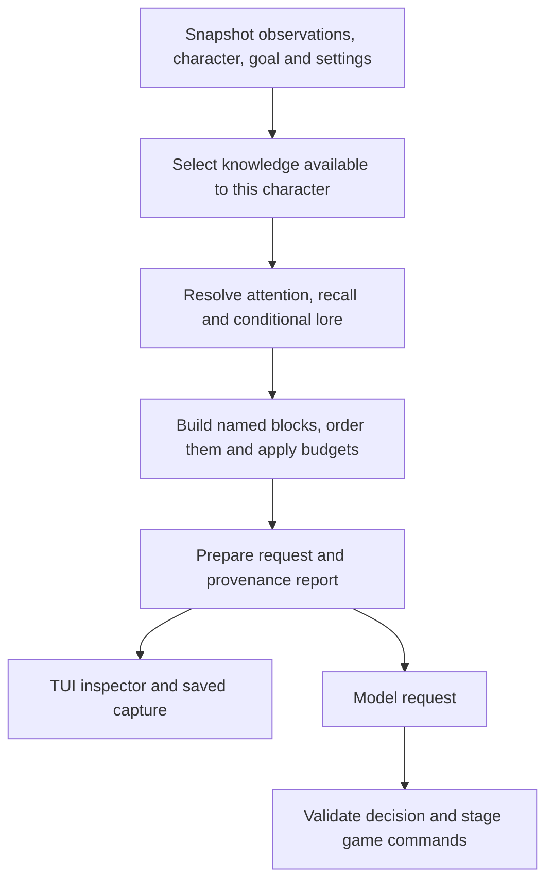

# Bot prompting: lessons from SillyTavern and TavernAI

Research date: 2026-09-09. This document preserves the baseline and proposals from
the review. The subsequent implementation now includes prompt composition and
inspection, eligible lore, temporary character state and selected voice examples;
see [the bot guide](bot.md#composed-prompts-and-inspection) for the implemented JSON
formats and [milestones](bot-milestones.md) for remaining work. Characters,
executable scripts and profiles remain JSON; this Markdown file is documentation.

The most useful next addition is a prompt composer with inspectable contributions.
It would make personality, recall, attention and experimental extensions easier to
understand and compare using the bot's existing captures, TUI and harness.

## What was checked

This review used official documentation and selected SillyTavern implementation
files from its moving `release` branch, accessed on the date above. It did not run
either application or benchmark their character quality.

The linked TavernAI project now describes TavernAI 2. Its current public repository
contains releases, documentation and community material; it links the original
1.x implementation separately. TavernAI 2 findings below describe documented
behavior, not an audit of its runtime source.
[TavernAI repository](https://github.com/TavernAI/TavernAI)

## Relevant patterns

| Pattern | Observed behavior | Application to our bot |
| --- | --- | --- |
| Prompt components | SillyTavern's Chat Completion Prompt Manager orders named components, assigns message roles, supports placement within history and activates components for particular generation types. [Prompt Manager](https://docs.sillytavern.app/usage/prompts/prompt-manager/) | Give goal decisions, social responses, runner questions and future memory jobs explicit compositions. Make placement an experiment parameter. |
| Character and voice | Character definitions include personality, scenario and example dialogue. Author's Note can insert a temporary instruction at a chosen position and frequency. [Character design](https://docs.sillytavern.app/usage/core-concepts/characterdesign/), [Author's Note](https://docs.sillytavern.app/usage/core-concepts/authors-note/) | Keep our authored background and values; select relevant voice examples and maintain temporary mood or conversational intent separately. Examples describe style, not encounters that happened. |
| Conditional context | World Info activates entries using keywords or regex, with placement, recursive activation, budgets and sticky/cooldown controls. [World Info](https://docs.sillytavern.app/usage/core-concepts/worldinfo/) | Add JSON lore entries with explicit eligibility and relevance rules. A keyword match must not confer knowledge. Bound recursion and record activation reasons. |
| Retrieval and summaries | Data Bank retrieves related document chunks using embeddings. Chat Vectorization temporarily relocates relevant old messages. Summarize maintains an editable generated summary and explicitly notes that details can be lost or invented. [Data Bank](https://docs.sillytavern.app/usage/core-concepts/data-bank/), [Chat Vectorization](https://docs.sillytavern.app/extensions/chat-vectorization/), [Summarize](https://docs.sillytavern.app/extensions/summarize/) | Compare lexical and semantic recall over the bot's eligible evidence. Keep amounts, routes and quotations tied to original records. Summaries remain derived views with source references. |
| Unified rules | TavernAI 2 puts conditional insertions, replacements, roles, placement and merge groups into a prompt tree. Its documented viewer exposes the assembled request and component sources. [Prompt Manager](https://tavernai.net/docs/prompt-manager/), [Final Prompt Viewer](https://tavernai.net/docs/advanced-features/) | Let the TUI edit blocks and show their exact contribution to the prepared request. Show exclusions as well as inclusions. |
| Separate histories | TavernAI's Multichat organizes independent histories and shared encounters, with configurable composition of histories when scenes connect. [Multichat](https://tavernai.net/docs/multichat/) | Keep each SSH bot's observation history private. A shared room event can enter several journals independently; meeting another bot must not merge their private memories. |

## How extensions change behavior

SillyTavern exposes pre-generation interceptors that can modify supplied context,
inject material or abort generation. It also exposes contextual background
generation and raw generation APIs, so an extension can introduce additional LLM
jobs beyond the visible reply.
[Extension APIs](https://docs.sillytavern.app/for-contributors/writing-extensions/)

The implementation confirms several consequential details:

- `runGenerationInterceptors` awaits interceptors sequentially in manifest order.
  An exception is logged and iteration continues; an explicit immediate abort can
  stop the remaining interceptors.
  [Interceptor implementation](https://raw.githubusercontent.com/SillyTavern/SillyTavern/release/public/scripts/extensions.js)
- `setExtensionPrompt` records position, depth, role, a filter and whether an
  injection participates in World Info scanning. The main generation path runs
  interceptors before World Info assembly and skips interceptors for `dryRun`.
  This means a dry-run path does not exercise all generation-time hooks.
  [Generation and injection implementation](https://raw.githubusercontent.com/SillyTavern/SillyTavern/release/public/script.js)
- The vector extension skips quiet generations. On applicable requests it can
  protect recent messages, retrieve older messages, remove selected messages from
  the working context array and insert their text through an extension prompt.
  This is context rearrangement, not simply appending another memory paragraph.
  [Vector implementation](https://raw.githubusercontent.com/SillyTavern/SillyTavern/release/public/scripts/extensions/vectors/index.js)
- Regex rules can affect stored text, only the display, or only outgoing prompts.
  Consequently, the visible transcript and model input can differ.
  [Regex extension](https://docs.sillytavern.app/extensions/regex/)

TavernAI 2 documents a different split: browser PM Scripts react to events and
maintain state, while server macros participate in prompt construction. Scripts
can share state with macros and request helper generations, either with normal
context or a custom raw prompt.
[PM Scripts](https://tavernai.net/docs/pm-scripts/)

For our experiments, these mechanisms imply that extension identity, ordering,
settings, selected evidence and auxiliary requests belong in the trace. Changing
one extension can also change what another extension retrieves or activates. A
display-only transformation should be distinguishable from a model-input change
and from a proposed game command.

## Where our implementation is today

The bot already has an authored character sheet with background, motivations,
relationships, opinions and voice examples; a separate recent-speech window;
durable experience and belief retrieval; route lookup; prompt editing; context
ablations; request captures; provider cost accounting; and experiment matrices.

The baseline composition examined during the review was relatively coarse:

- [`Prompts`](../crates/mush-bot/src/experiment.rs) selects a decision or question
  system string and appends a supplement. Context controls mostly enable fields
  or bound their byte sizes.
- [`App::context`](../crates/mush-bot/src/runner.rs) gathers character, speech,
  instructions, terminal history, references, recalled experiences and routes into
  one JSON object.
- [`Brain::prepare`](../crates/mush-bot/src/model.rs) sends the system string,
  serialized context and optional runner question. Captures preserve that request.
- [`Knowledge`](../crates/mush-bot/src/knowledge.rs) retrieves lexical matches
  from bundled help and supplied documents. It has no per-entry character
  knowledge eligibility model.

At that point we could inspect the final request, but had no report explaining each
component's activation, budget decision, transformation or omission. Nor did we
have a general extension execution pipeline. Adding more character adjectives
would not address that gap.

## Proposed composition and inspection

Keep this implementation inside `mush-bot`, independent of the NPC system. Start
with built-in Rust components configured by versioned JSON. Preserve existing
version-1 profiles and exact request replay while introducing the richer format
explicitly.

Each proposed block should have a stable ID, source and revision, content kind,
applicable prompt purposes, ordering/placement, activation conditions, budget
priority and evidence references. Source kind and model message role are separate:
retrieved dialogue remains observed data regardless of where it appears in a
provider's message array.

The initial block set should cover the action protocol, runner objective,
character identity, selected voice examples, temporary character state, recent
speech, current observations, remembered evidence, eligible lore and response
instructions. Recent engagement gets a protected allocation so older lore cannot
silently evict the utterance that triggered a response. Reserve output space and
fail preparation clearly if required context cannot fit. Label token estimates
when the selected model's exact tokenizer is unavailable.

The inspector should answer:

- Why is this block present, and which observation or profile activated it?
- What did the character know that allowed this information to be included?
- What was excluded by eligibility, relevance, an ablation or the budget?
- Which component changed this text, and what changed?
- What request was actually prepared, and how does it differ from the prior turn?

Prepare one immutable request artifact for inspection and dispatch. If new speech
or settings invalidate it, mark it stale and prepare again. A passive inspection
must not launch hidden paid jobs; show missing derived inputs, or inspect the last
completed preparation. Auxiliary work performed during preparation must be logged
and its outputs captured. Replaying the assembly requires those outputs and state
snapshots; replaying only the final request remains the simpler existing mode.
Neither mode guarantees identical live model responses.

## Knowledge, personality and attention rules

Eligibility precedes retrieval. Distinguish command reference material, explicitly
granted prior knowledge, observed evidence and derived beliefs. An author-only
world secret should remain outside the bot's model context and retrieval index.
Being supplied a wiki directory is not enough to classify every entry as an
in-character memory; future knowledge manifests need to express those grants.

For the Marco example, preserve three possibilities: the interface supplies a
speaker label; the bot heard someone introduce themselves as Marco; or the
character's authored background already establishes an acquaintance. Those have
different evidence. A price stated by Marco is also different from a price the
bot actually paid. The prompt should retain that distinction when recalling it.

Keep authored personality stable, but give temporary state a separate lifetime:
current mood, an unresolved concern, recent conversational intent, or a changing
relationship belief. Updates should identify their trigger and uncertainty. A
style example can guide how Rose declines an invitation without becoming a memory
that Rose previously received that invitation.

Attention activation and lore activation serve different purposes. Receiving an
utterance may schedule a decision; mentioning a topic may select context. A lore
match must not automatically send a reply. Preserve speech sequence IDs, response
cooldowns and the existing goal so a conversation can progress without restarting
completed work. Test direct address, overheard mentions, self echoes, interruptions
and an appropriate choice to remain silent.

## Extension boundary and evaluation

First establish typed stages for context selection, prompt contribution, derived
state proposals and display formatting. Each component declares its stage,
configuration version, ordering and whether it needs auxiliary model calls.
Resolve ordering ties deterministically and capture any random choices or external
results. A required component failure should pause the turn; an optional component
failure should be visible in the trace, not an unexplained omission.

All auxiliary model work should use the bot's request/cost machinery with parent
request, component and purpose IDs. Provider-reported cost belongs to its request.
Any allocation of that request's cost among prompt blocks is an estimate and must
be labeled accordingly. Include auxiliary spend and latency when comparing a
retrieval or summarization strategy against the baseline.

Keep game commands behind the normal validation, staging and SSH path. Display
formatting must not edit observation evidence or executable commands. JSON profiles
should select known components; they need not carry arbitrary executable code.
External process extensions can be considered later with an explicit JSON protocol
once actual experiments expose the needed interface.

Recommended implementation order:

1. Named prompt blocks, provenance capture and a TUI inspector using the same
   prepared request as dispatch; preserve current behavior as the baseline.
2. JSON lore eligibility/activation plus explicit temporary character state and
   selectable voice examples.
3. Swappable recall and summary components with captured auxiliary calls, followed
   by harness comparisons across component configurations.

Acceptance scenarios should include a label-only Marco, a prior acquaintance,
different prices mentioned versus paid, a private conversation heard by only one
bot, a recalled route after history truncation, a voice example that must not
become a remembered encounter, and recent speech surviving a crowded prompt.
Structural assertions can verify exclusions and provenance deterministically;
character consistency and conversational quality require repeated behavioral
evaluations alongside cost, latency and task success.
