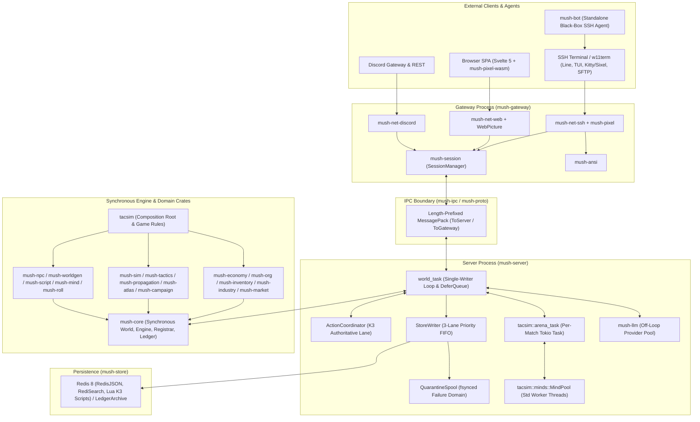

# Architectural Design Review: `rustmush`

**Date:** 2026-10-28  
**Reviewed Commit:** `2cbe9f7c` (`main`)

---

## 1. Executive Summary & Codebase Scale

`rustmush` is an ambitiously engineered, production-hardened reimagining of the TinyMUX/TinyMUSH tradition in Rust (Edition 2024). Rather than stopping at a classic text-only telnet server with softcode, it combines:
- **Multi-surface native clients**: SSH (`russh` line mode + `ratatui` modal TUI + 20 Hz Kitty/Sixel 3D/2.5D cockpit graphics + in-connection read-only SFTP audio asset streaming), a structured WebSocket + Svelte 5 SPA (`axum` + WebAssembly software renderer), and a Discord bot/relay bridge (`twilight`).
- **A split-process fault-tolerant topology**: Zero-downtime server restarts via [`mush-gateway`](../../crates/mush-gateway/src/lib.rs) supervising [`mush-server`](../../crates/mush-server/src/lib.rs) over a length-prefixed MessagePack IPC boundary ([`mush-ipc`](../../crates/mush-ipc/src/lib.rs)), while preserving an in-process single-binary deployment mode ([`mushd`](../../crates/mushd/src/lib.rs)).
- **A deep 2350-era hard-sci-fi simulation (`tacsim`)**: Orbital Keplerian ephemerides, double-entry accounting, physical custody/inventory reservation books, surface mining, light-lagged communications relays, a separate-task deterministic combat arena, and dual AI stacks (deterministic op-and-fee budgeted Rhai unit minds in [`mush-mind`](../../crates/mush-mind/src/lib.rs) and off-loop LLM agents in [`mush-npc`](../../crates/mush-npc/src/lib.rs) / [`mush-worldgen`](../../crates/mush-worldgen/src/lib.rs)).

### Quantitative Workspace Footprint
Across **49 crates** in `crates/` (48 in the root Cargo workspace plus the standalone [`mush-pixel-wasm`](../../crates/mush-pixel-wasm/Cargo.toml) cdylib), the repository contains **~1.73 million lines of Rust** (**1,093,519 lines** across 1,419 `src/` files and **639,242 lines** across 614 `tests/` files):

| Crate | `src/` Files | `src/` LoC | `tests/` Files | `tests/` LoC | Total LoC | Architectural Role |
|---|---:|---:|---:|---:|---:|---|
| [`tacsim`](../../crates/tacsim/Cargo.toml) | 394 | 376,106 | 179 | 290,700 | **666,806** | Game composition root, combat arena, orbital sky, surface mining, unit minds |
| [`mush-core`](../../crates/mush-core/Cargo.toml) | 109 | 103,823 | 54 | 35,640 | **139,463** | Synchronous `World`, `Engine`, `GameModule` API, K1–K8 authoritative kernel |
| [`mush-economy`](../../crates/mush-economy/Cargo.toml) | 137 | 74,736 | 41 | 46,344 | **121,080** | Double-entry journal, accounts, holds, obligations, contracts |
| [`mush-bot`](../../crates/mush-bot/Cargo.toml) | 65 | 67,978 | 33 | 31,163 | **99,141** | Standalone external SSH playtesting agent & cast harness |
| [`mush-server`](../../crates/mush-server/Cargo.toml) | 27 | 47,422 | 45 | 43,094 | **90,516** | Forked server half: `world_task`, `ActionCoordinator`, store writer, quarantine |
| [`mush-roll`](../../crates/mush-roll/Cargo.toml) | 232 | 69,686 | 45 | 18,074 | **87,760** | Character-owned unit-mind drafts, sealed revisions, commercial licensing |
| [`mush-market`](../../crates/mush-market/Cargo.toml) | 100 | 34,581 | 22 | 16,842 | **51,423** | Catalogs, listings, quotes, NPC market makers, privacy-safe projections |
| [`mush-net-ssh`](../../crates/mush-net-ssh/Cargo.toml) | 26 | 41,852 | 9 | 7,654 | **49,506** | `russh` server, line editor, `ratatui` TUI, Kitty/Sixel streamer, SFTP assets |
| [`mushd`](../../crates/mushd/Cargo.toml) | 5 | 1,517 | 49 | 41,742 | **43,259** | All-in-one binary gluing `mush-gateway` + `mush-server` in-process |
| [`mush-industry`](../../crates/mush-industry/Cargo.toml) | 55 | 26,633 | 12 | 15,907 | **42,540** | Ore deposits, deterministic surveys, claims, extraction, facilities |
| [`mush-sim`](../../crates/mush-sim/Cargo.toml) | 22 | 24,165 | 15 | 15,458 | **39,623** | Spatial domains, interior placement, `CarrierJourney`, control leases |
| [`mush-atlas`](../../crates/mush-atlas/Cargo.toml) | 28 | 26,551 | 15 | 8,902 | **35,453** | 2.5D metric rooms, tiles, portals, Bresenham LOS, A* pathfinding |
| *Other 37 Crates* | 319 | 198,469 | 145 | 107,722 | **306,191** | `mush-store`, `mush-gateway`, `mush-tactics`, `mush-pixel`, `mush-mind`, etc. |

---

## 2. System Topology & Crate Dependency Architecture

The workspace is organized into a layered Directed Acyclic Graph (DAG) with two primary deployment topologies:
1. **Split-Process Production Mode**: [`mush-gateway`](../../crates/mush-gateway/src/lib.rs) owns external listeners (SSH, Web/WS, Discord), session fan-out ([`mush-session`](../../crates/mush-session/src/lib.rs)), and auth/siteban keys in Redis, while supervising [`mush-server`](../../crates/mush-server/src/lib.rs) over a local socket (`ToServer` / `ToGateway` frames in [`mush-ipc`](../../crates/mush-ipc/src/protocol.rs)).
2. **All-in-One Mode ([`mushd`](../../crates/mushd/src/inprocess.rs))**: Runs the exact same `mush-server` world loop and `mush-gateway` bridges in one process over an `InProcessSink` backed by a shared `Arc<SessionManager>`.

---

## 3. Core Architectural Strengths

### 3.1 Pure Synchronous Core (`mush-core`) & Single-Writer Ownership
[`mush-core`](../../crates/mush-core/src/lib.rs) contains **zero** Tokio, async, network, or database dependencies. [`World`](../../crates/mush-core/src/world.rs) is plain in-RAM data owned outright by a single task (`mush-server::world_task`), eliminating lock contention, deadlocks, and `Arc<Mutex<...>>` sprawl across game logic.
- **Monotonic `ObjId(u32)` with tombstones**: Never recycling dbrefs eliminates the classic MU* stale-pointer aliasing bug class.
- **Two-phase async `Effects` pattern**: Command handlers and hooks remain synchronous functions (`fn(&mut Ctx<'_>) -> Result<(), CmdError>`). When off-loop work is required (LLM generation, NPC turns, atlas window compositing), handlers snapshot what they need on-loop, push a declarative [`Effect`](../../crates/mush-core/src/engine.rs), and return immediately. When the off-loop task completes, it re-enters via `Inbound::Apply(WorldCommand::ModuleAsyncDone)` and re-validates against current world state before applying.

### 3.2 Split-Process Fault Isolation & Deterministic Reply Framing
The separation between [`mush-gateway`](../../crates/mush-gateway/src/lib.rs) and [`mush-server`](../../crates/mush-server/src/lib.rs) is thoughtfully engineered:
- **`mush-session` is world-ignorant**: [`mush-session`](../../crates/mush-session/src/lib.rs) does not even depend on `mush-core`; it maps `CharKey(u64)` to `ConnectionHandle`s and clones a single `Arc<OutputEvent>` across all connections in a room.
- **Must-deliver boundary semantics**: If the server-to-gateway channel (`to_gw_cap`) overflows or a socket write times out, [`writer_loop`](../../crates/mush-server/src/lib.rs) never silently drops a message (which could lose a state keyframe); instead, it tears down the IPC socket so the gateway supervisor relaunches/re-attaches and re-renders every active session.
- **Unwind isolation**: Every synchronous engine dispatch in [`world_task.rs`](../../crates/mush-server/src/world_task.rs) runs inside a `guarded!` `catch_unwind` boundary. A panic transitions the server to `WorldMode::IntegrityFrozen`, discards unacknowledged step residue, drains the persistence writer and fsyncs the quarantine spool, and exits non-zero so `mush-gateway` heals the server without dropping player SSH/WebSocket sessions.

### 3.3 High-Assurance Persistence: K3 Authoritative Bundles & Quarantine Spool
Persistence in [`mush-store`](../../crates/mush-store/src/redis.rs) and [`mush-server/src/persist.rs`](../../crates/mush-server/src/persist.rs) goes well beyond naive write-through:
- **3-Lane Priority FIFO Writer**: [`StoreWriter`](../../crates/mush-server/src/persist.rs) separates `WRITER_LEGACY_QUEUE` (64), `WRITER_AUTHORITATIVE_QUEUE` (16), and `WRITER_CONTROL_QUEUE` (8) for admission backpressure while merging them via a monotonic `next_order: AtomicU64` so legacy writes cannot starve authoritative actions or `BGSAVE` control jobs, yet commit order remains strictly sequential.
- **Two-phase Redis Lua atomic commits**: K3 authoritative actions use [`ActionCoordinator`](../../crates/mush-server/src/action_coordinator.rs) to run a mandatory preflight check before any RNG draw, then execute `reserve_authoritative.lua` and `finalize_authoritative.lua` in Redis. Crucially, for K3 actions, `complete_pending_commit` only installs the typed post-images into RAM *after* the store receipt succeeds.
- **Filesystem Quarantine Spool ([`quarantine.rs`](../../crates/mush-server/src/quarantine.rs))**: If an authoritative commit or poison ledger seal fails mid-flight, the server fsyncs a content-addressed recovery record into `<data_dir>/quarantine` (a separate failure domain from Redis) and halts. On reboot, `prepare_quarantine_for_writable_boot` reconciles exact target matches before allowing any schema migration or world seed write.

### 3.4 Capability-Based Domain DAG (`Economy`, `Inventory`, `Industry`, `Market`, `Canon`)
The domain crates (`mush-org`, `mush-economy`, `mush-inventory`, `mush-industry`, `mush-market`, `mush-campaign`, `mush-canon`, `mush-faction`) maintain a cycle-free dependency graph while supporting rich cross-system transactions:
- **Single Quantity Authority**: Neither `mush-industry`, `mush-market`, nor `tacsim` maintains private stock numbers; all physical quantities live in [`mush-inventory`](../../crates/mush-inventory/src/lib.rs) pools and lots bound to E3 custody vaults. Cross-crate atomic mutations work via explicit registration-time capability cells (`InventoryHandleCell`, `IndustryHandleCell`) paired with `reg.delegate_state_families(...)` in [`compose_server_modules`](../../crates/tacsim/src/composition/mod.rs).
- **Decoupled Consequence Loop**: `mush-campaign` has no dependency on `mush-faction`; instead, campaign resolution writes a root record to [`mush-canon`](../../crates/mush-canon/src/lib.rs), which fires `WorldEvent::CanonRecorded` (with `ctx.out.pin_deferred()` so later errors cannot un-persist committed RAM side effects), driving `mush-faction` clocks and `mush-economy` contract attestations (`MAX_OBSERVER_DEPTH = 4`).

### 3.5 Dual Rhai Engines & Defense-in-Depth AI Boundaries
The codebase makes a clean architectural distinction between builder scripts and autonomous combat unit minds:
- **[`mush-mind`](../../crates/mush-mind/src/engine.rs)**: Depends *only* on `rhai = "=1.26.0"` (zero other crates, not even `serde`). It constructs a raw Rhai engine with only 7 core packages (no clock, no math/trig, no floats in its hand-rolled canonical JSON memory codec in [`memory.rs`](../../crates/mush-mind/src/memory.rs)), counts operations itself in a thread-local budget to defeat Rhai callback state-cloning bypasses, and latches station refusals in a thread-local `REFUSAL` cell so script `try/catch` blocks cannot swallow kernel errors.
- **[`mush-npc`](../../crates/mush-npc/src/lib.rs)**: Treats the typed `NpcAction` allowlist (`say`, `pose`, `move`, `look_at`, `remember`, `use_ability`, `do_nothing`) re-validated on the world loop—not the LLM prompt—as the security boundary.

### 3.6 Executable Architectural Governance (`mush-contract-tests`)
Few codebases enforce their architectural rules as rigorously in CI as `rustmush` does via [`mush-contract-tests`](../../crates/mush-contract-tests/src/lib.rs):
- **Panic-surface ratchet & ceiling ([`panic_budget.rs`](../../crates/mush-contract-tests/tests/panic_budget.rs))**: Lexes all production `src/` files across 45 crates to count `.unwrap(`, `.expect(`, `panic!`, `unreachable!`, `todo!`, and `unimplemented!` (currently 545 total sites across `panic_budget/*.txt`), enforcing a strict downward-only ratchet on the 9 pre-auth network/gateway crates (`mush-ansi`, `mush-ipc`, and `mush-session` are held at **0**).
- **Per-crate restriction lint floors ([`restriction_lints.rs`](../../crates/mush-contract-tests/tests/restriction_lints.rs))**: Holds 8 crates (`mush-atlas`, `mush-content`, `mush-mind`, `mush-party`, `mush-pixel`, `mush-pixel-wasm`, `mush-roll`, `mush-session`) at zero across all 6 panic-shaped Clippy lints (`unwrap_used`, `expect_used`, `indexing_slicing`, `panic`, `unreachable`, `panic_in_result_fn`).
- **Source & type tripwires**: [`arena_library.rs`](../../crates/mush-contract-tests/tests/arena_library.rs) forbids `tokio`, `mush_store`, `HashMap`, or `&mut World` inside `crates/tacsim/src/arena/`; [`truth_serialization_policy.rs`](../../crates/mush-contract-tests/tests/truth_serialization_policy.rs) uses `assert_not_impl_any!` to guarantee private truth types (`GeologySecret`, `PocketRow`, `ResolvedActionInvocation`) never implement `Serialize`.

---

## 4. Architectural Tensions, Structural Risks & Findings

> [!IMPORTANT]
> The findings below focus on structural seams, coupling inversions, concurrency bottlenecks, and governance gaps identified directly in the current tree.

### Finding 1 (High — Boundary Inversion & Coupling): Blurred "Platform vs. Game" Seam Between `mush-server` and `tacsim`
- **What the architecture claims**: In milestone `16b cut R-a`, the production module composition root moved from `mush-server` into [`crates/tacsim/src/composition/mod.rs`](../../crates/tacsim/src/composition/mod.rs) so that *"the game crate composes every module it boots. No engine crate depends back on this one"*. Meanwhile, [`crates/tacsim/src/lib.rs`](../../crates/tacsim/src/lib.rs) and [`crates/tacsim/Cargo.toml`](../../crates/tacsim/Cargo.toml) still carry the E7 cut-1 doc claim that `tacsim -> {mush-core, mush-sim}` and nothing else.
- **What the code actually does**:
  1. `tacsim` is simultaneously a leaf domain module (`TacsimRuleset`, `PilotRuleset`), a pure combat library (`tacsim::arena`), and the top-level module composition root depending on **34 workspace crates** ([`crates/tacsim/Cargo.toml`](../../crates/tacsim/Cargo.toml)).
  2. Conversely, [`mush-server`](../../crates/mush-server/Cargo.toml) depends directly on `tacsim` and embeds `tacsim`-specific runtime types deep inside the host server loop:
     - [`crates/mush-server/src/world_task.rs`](../../crates/mush-server/src/world_task.rs) hardcodes `arenas: Option<tacsim::arena_bridge::ArenaTasks>`, `Wake::ArenaEgress(Box<tacsim::arena_task::ArenaOut>)`, an `arena_egress` branch in the main `tokio::select!` loop (lines 4531–4544, 5285–5325), and `arenas.ack_ledger_upto(...)` (line 4443).
     - [`crates/mush-server/src/boot.rs`](../../crates/mush-server/src/boot.rs) hardcodes `tacsim::surface::GeologyBoot`, `DurableGeologyKeyStore`, and `load_launch_deployment`.
     - [`crates/mush-server/src/config_ext.rs`](../../crates/mush-server/src/config_ext.rs) hardcodes `tacsim_config`, `tacsim_economy_config`, and `TACSIM_INTERLOCK_REFUSED`.
- **Impact**: Every change to `mush-comsys`, `mush-mail`, `mush-weather`, or `mush-housing` invalidates compilation of `tacsim` (666k LoC), and `mush-server` cannot be compiled or tested without compiling all of `tacsim`.

### Finding 2 (High — Maintainability & Compile Times): Monolithic "God Files" in Critical Paths
Several load-bearing modules have grown into massive single-file compilation and cognitive units:
- [`crates/mush-server/src/world_task.rs`](../../crates/mush-server/src/world_task.rs): **22,132 lines** (925 KB) in a single file (~10,530 lines of production state machines and ~11,600 lines of inline tests). It interleaves `WorldMode` state transitions, `DeferQueue` admission, 15 `tokio::select!` wake arms, K3 vs. legacy commit flushing, and hardcoded `if module.as_str() == ...` effect dispatchers (lines 10350–10450).
- [`crates/tacsim/src/arena/step.rs`](../../crates/tacsim/src/arena/step.rs): **9,859 lines** (465 KB) in a single file.
- [`crates/mush-core/src/engine.rs`](../../crates/mush-core/src/engine.rs): **8,733 lines** (348 KB) in a single file.
- [`crates/tacsim/src/arena_task.rs`](../../crates/tacsim/src/arena_task.rs): **3,816 lines** (170 KB).
- [`crates/mush-store/src/redis.rs`](../../crates/mush-store/src/redis.rs): **3,999 lines** (171 KB).

### Finding 3 (Medium-High — Dual-Track Complexity): Coexistence of Legacy and Authoritative (K3/K7) Architectures
Across four subsystems, a newer "authoritative" architecture has been layered alongside an older "legacy" architecture without fully retiring the older path:
1. **Two Persistence & State Models (`ActionStateStore` vs. `World` / Module Slots)**:
   - In the K3 authoritative lane (`flush_prepared_action` in [`world_task.rs`](../../crates/mush-server/src/world_task.rs)), RAM state is untouched until Redis acknowledges the commit (`complete_pending_commit` at line 9876).
   - In the legacy lane (`flush_dirty` in [`world_task.rs`](../../crates/mush-server/src/world_task.rs)), `Engine::step` mutates `World` and `module_state` in RAM *immediately*, before the store write finishes. Because RAM holds a tentative post-image during `WorldMode::CommitPending`, `world_task` must maintain a complex `DeferQueue` (lines 957–1228) to block gameplay reads and commands from observing uncommitted state.
   - According to [`legacy-handlers.toml`](../../crates/mush-contract-tests/legacy-handlers.toml), out of **195 pinned command stanzas**, **97 are `baseline`**, **35 are `legacy-post-image`**, **1 is `economy-carve-out`**, **16 are `read-only`**, and **46 are `authoritative`**.
2. **Two Tactical Combat Stacks**:
   - World-loop [`mush-sim`](../../crates/mush-sim/src/lib.rs) + [`mush-tactics`](../../crates/mush-tactics/src/lib.rs) + [`mush-propagation`](../../crates/mush-propagation/src/lib.rs) + [`tactics_outbox.rs`](../../crates/mush-server/src/tactics_outbox.rs) (whose domain pulse outbox still notes a provisional `draw % 2` hit/miss rule) vs. the off-loop deterministic [`tacsim::arena`](../../crates/tacsim/src/arena/mod.rs) where actual tank/mech combat runs.
3. **Two Async NPC Execution Paths in [`mush-npc`](../../crates/mush-npc/src/lib.rs)**:
   - The M8 `Effect::ModuleAsync` path (`run_npc_turn_async` dispatched in `world_task.rs:10382`) coexists with the K7 durable decision-capture path (`npc_decide` / `npc_lease` / `npc_idle` driven by [`decision_llm.rs`](../../crates/mush-server/src/decision_llm.rs)).
4. **Two Content Pack Formats**:
   - Engine-wide [`mush-content::Pack`](../../crates/mush-content/src/lib.rs) vs. [`tacsim::pack::RulesPack`](../../crates/tacsim/src/pack.rs).

### Finding 4 (Medium — Governance & Dependency Leak): `mush-testkit` Is Linked as a Normal Dependency in Production Binaries
- **Evidence**:
  - [`crates/mush-server/Cargo.toml`](../../crates/mush-server/Cargo.toml) and [`crates/mushd/Cargo.toml`](../../crates/mushd/Cargo.toml) both declare `mush-testkit.workspace = true` under `[dependencies]` (in addition to `[dev-dependencies]`).
  - [`crates/mushd/src/repl.rs`](../../crates/mushd/src/repl.rs) imports `use mush_testkit::text_of;` in production code, while `crates/mush-server/src/` only uses `mush_testkit` inside `#[cfg(test)]` modules (and a comment at `world_task.rs:2015` even remarks *"the testkit is a dev..."*).
  - Meanwhile, [`crates/mush-contract-tests/tests/panic_budget.rs`](../../crates/mush-contract-tests/tests/panic_budget.rs) explicitly excludes `crates/mush-testkit/**` (`EXCLUDED_CRATES` at line 118) with the justification: *"test scaffolding that is only ever linked by test targets"*.
- **Impact**: `mush-testkit` is compiled and linked into release builds of `mush-server` and `mushd`, violating the invariant documented in `panic_budget.rs`.

### Finding 5 (Medium — Throughput & Concurrency Ceiling): Single-Flight `CommitPending` Window & Off-Loop Worker Contention
- **Single-flight commit serialization**: Because `WorldMode::CommitPending` allows only **one** persistence batch in flight at a time and holds subsequent mutating/reading commands in `DeferQueue` (`COMMAND_DEFER_CAP = 64`, `COMMAND_DEFER_MS = 250ms`), maximum mutating command throughput is strictly bounded by sequential Redis round-trip + `appendfsync` latency (`1 / RTT_commit`). Under burst load or elevated disk fsync latency on `appendfsync always`, the 64-slot `DeferQueue` can saturate within 250 ms and reject commands with `CommitTimedOut`.
- **Rayon frame worker contention (Gate 4 / `T-106`)**: In [`crates/tacsim/src/arena/step.rs`](../../crates/tacsim/src/arena/step.rs), parallelizing `frame_for` across a `rayon` thread pool regressed wake p50 by **+11.2%** on 24-pilot cohorts ([`24-performance-client-debt.md`](24-performance-client-debt.md)) because per-frame work is fine-grained and dominated by cross-thread fork/join and allocation overhead.
- **Dual Web Picture Renderers**: [`mush-net-web/src/picture.rs`](../../crates/mush-net-web/src/picture.rs) maintains a server-side 20 Hz PNG renderer (`WebPicture`) alongside client-side [`mush-pixel-wasm`](../../crates/mush-pixel-wasm/src/lib.rs) because `PictureKind::Overhead` is not yet exposed through the WASM C ABI.

### Finding 6 (Low-Medium — Workspace Build Ergonomics): `mush-bot` Feature Unification Hazard
- [`crates/mush-bot/Cargo.toml`](../../crates/mush-bot/Cargo.toml) enables `serde_json = { workspace = true, features = ["arbitrary_precision"] }`. Because Cargo unifies features across workspace members and `arbitrary_precision` changes `serde_json`'s internal number representation in a way that breaks `#[serde(untagged)]` / `#[serde(flatten)]` deserialization in `mush-worldgen`, running plain `cargo test --workspace` fails; every test command must pass `--exclude mush-bot`.

---

## 5. Prioritized Recommendations

| Priority | Area | Recommendation | Target Files |
|---|---|---|---|
| **P0 (Quick Win)** | Dependency & Gate Hygiene | Remove `mush-testkit` from `[dependencies]` in `mush-server` and `mushd`. Move the tiny `text_of(&OutputEvent)` helper (or a display adapter) into `mush-proto` or `mush-core::output`, and add a contract test asserting no binary links `mush-testkit` outside `[dev-dependencies]`. | [`crates/mush-server/Cargo.toml`](../../crates/mush-server/Cargo.toml), [`crates/mushd/Cargo.toml`](../../crates/mushd/Cargo.toml), [`crates/mushd/src/repl.rs`](../../crates/mushd/src/repl.rs) |
| **P1 (Quick Win)** | Build Ergonomics | Replace `serde_json/arbitrary_precision` in `mush-bot` with fixed-point integer nanodollars (`i128` / `u64`, matching `mush-economy::Amount`'s pattern) or a dedicated decimal type for LLM cost tracking, so `cargo test --workspace` works without `--exclude mush-bot`. | [`crates/mush-bot/Cargo.toml`](../../crates/mush-bot/Cargo.toml) |
| **P1 (Structural)** | Composition Boundary | Extract `crates/tacsim/src/composition/` into a dedicated composition crate (or move composition into `mush-server`), and abstract `ArenaTasks` / `GeologyBoot` behind engine/server traits (e.g., an `OffLoopSimulationHost` trait registered by `GameModule`) so `mush-server` does not hardcode `tacsim` types in `world_task.rs`, and `tacsim` drops its 25+ unrelated module dependencies (`mush-mail`, `mush-weather`, `mush-comsys`, etc.). Update the stale E7 cut-1 dependency claims in `tacsim/src/lib.rs`. | [`crates/tacsim/Cargo.toml`](../../crates/tacsim/Cargo.toml), [`crates/tacsim/src/lib.rs`](../../crates/tacsim/src/lib.rs), [`crates/mush-server/src/world_task.rs`](../../crates/mush-server/src/world_task.rs) |
| **P2 (Modularization)** | God-File Decomposition | Split [`world_task.rs`](../../crates/mush-server/src/world_task.rs) (22k LoC) into focused submodules under `crates/mush-server/src/world_task/` (`mode.rs`, `defer_queue.rs`, `commit_pipeline.rs`, `effects_dispatch.rs`, and move the 11.6k LoC of inline tests into `world_task/tests/`). Replace the hardcoded `if module.as_str() == ...` chain in `spawn_effect_list` with a typed `AsyncEffectRunner` registry installed at boot. Similarly decompose [`arena/step.rs`](../../crates/tacsim/src/arena/step.rs) (9.8k LoC) by substep phase (movement, sensors, weapons, frames). | [`crates/mush-server/src/world_task.rs`](../../crates/mush-server/src/world_task.rs), [`crates/tacsim/src/arena/step.rs`](../../crates/tacsim/src/arena/step.rs) |
| **P2 (Client/WASM)** | Unify Web Pixel Rendering | Export `PictureKind::Overhead` (and remaining Bucket B views) in [`mush-pixel-wasm`](../../crates/mush-pixel-wasm/src/lib.rs) so the web SPA renders all pictures client-side via WASM, allowing [`mush-net-web/src/picture.rs`](../../crates/mush-net-web/src/picture.rs) to retire server-side 20 Hz PNG encoding for web clients. | [`crates/mush-pixel-wasm/src/lib.rs`](../../crates/mush-pixel-wasm/src/lib.rs), [`crates/mush-net-web/src/picture.rs`](../../crates/mush-net-web/src/picture.rs) |
| **P3 (Convergence)** | Retire Dual-Track Debt | Complete the K8.5 classification of the remaining 97 `baseline` stanzas in [`legacy-handlers.toml`](../../crates/mush-contract-tests/legacy-handlers.toml), consolidate `mush-npc` onto a single async decision path, and either retire or complete the placeholder `TacticsBoundaryOutbox` (`draw % 2`) in [`tactics_outbox.rs`](../../crates/mush-server/src/tactics_outbox.rs). | [`crates/mush-contract-tests/legacy-handlers.toml`](../../crates/mush-contract-tests/legacy-handlers.toml), [`crates/mush-server/src/tactics_outbox.rs`](../../crates/mush-server/src/tactics_outbox.rs) |
