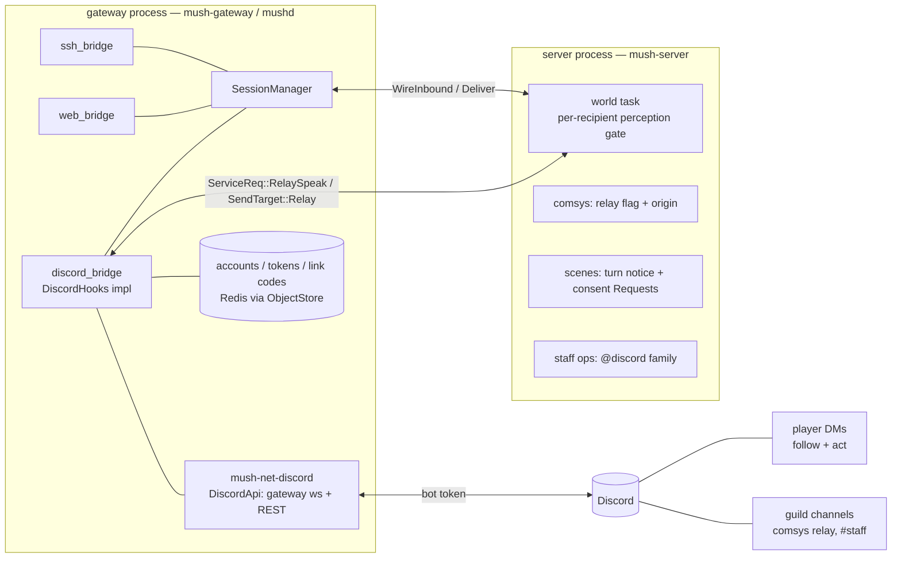

# 03 — Discord, the fourth interface: owner questions

**Answered 2026-09-06 (partial): the owner accepted 1A 2A 3A 4A 5A 6A 7A 8A 9A 10A 11A 12A 14A — binding.
11A with a constraint: the doc 09 on-call service is built immediately after this programme, so D must
ship the interfaces it needs (§7a). 12A's "defer the fork" is therefore withdrawn — the fork is decided
in §7a. Q13 (the library): the spike ran the same day and **confirms 13A (twilight)** — §4 Q13 "Spike" —
**13A confirmed by the owner (2026-09-06).** **15A accepted with the owner's amendment** (a dedicated, explicitly granted
privilege — never implied by Wizard — with the grant and every use audited durably, the observed data
never logged; §4 Q15). The survey is closed; the plan is [04-discord-implementation-plan.md](04-discord-implementation-plan.md).**

**Draft 0.1 — 2026-09-06.** A first pass at *how* a Discord interface would be built on the tree and *what
the owner must decide* before a design and implementation plan is written, in the shape of
[08e](../design/08e-e6-owner-questions.md) / [10a](../design/10a-tacsim-e7-owner-questions.md): numbered
questions, lettered options with a **recommended** default, and the code fact each recommendation rests
on. Answer `1A, 2A, …`, or `defaults` to take every recommendation. Grounded in the tree at `48eda83`
(`origin/main`, "E7 cut 6 independent verify fold"); every `file:line` was read.

Programme letter proposed: **D**; cuts D1…; decisions D-D-n once the plan exists (the letter is the
owner's to change).

---

## 1. What the owner asked for, as requirements

The goal in the owner's words: Discord as a fourth, **very lossy** interface, so that a player in a scene
who has to leave the terminal / web client can still *follow* the scene from their character's
perspective and knowledge, still *act* (speech, mechanics, agreeing or disagreeing with rulings), so
"the slow middle part of a scene doesn't stop hard"; staff paging as a natural Discord channel; and a
comsys ↔ Discord bridge through a bot that *authenticates* that the Discord user speaking is the player
the message appears as in game — which needs a Discord handle registration workflow.

Restated as requirements the plan will be checked against:

- **R0 — Verified link.** An account may bind exactly one Discord identity, proven in both directions
  (the player controls the account *and* the Discord user), revocable, staff-auditable.
- **R1 — Follow.** A linked player can receive, on Discord, what their character perceives — never more
  than their terminal would show — while their session stays alive in the scene.
- **R2 — Act.** From Discord the player can speak, pose, roll, answer server-initiated requests
  (consent, rulings, targeting), and reach the safety commands; every line runs as the character under
  the same gates as a typed line.
- **R3 — Staff paging.** Requests for staff and staff-channel traffic reach a Discord channel and staff
  can answer from it, attributed correctly.
- **R4 — Comsys bridge.** Configured game channels mirror into Discord channels and back; a Discord
  message appears in game as the linked player's character, and the bot is the only thing that can
  assert that attribution.
- **Lossy by design.** Discord's limits (2 000-character messages, per-channel and global rate limits,
  no ANSI, no panels) mean the surface drops, coalesces, and summarizes. What it must never do is
  *over*-include: a line the terminal would withhold cannot appear in a DM.

Out of scope for this pass (named so they are not assumed): the doc 09 on-call incident paging service
(SMS/email/Discord for *operational* incidents — it reuses R0 and is deferred, §7), Discord OAuth on the
web client (a follow-on to R0), and a shared "scene thread" in a guild (§7).

## 2. Grounding: what the tree has today

- **The gateway/server split is already the seam a transport plugs into.** Bridges live in
  `mush-gateway` and speak the boundary protocol: the SSH bridge (`crates/mush-gateway/src/ssh_bridge.rs`)
  and the web bridge (`web_bridge.rs`) both delegate every game-side flow to one shared
  `GameBridge` (`bridge_common.rs:210`): `enter_game` attaches an *already-authenticated* connection
  handle to a character (`:855` — session attach, world `ConnUp`, `SessionInfo`, initial `look`),
  `line` (`:971`, sanitize + flood + custody), `respond` (`:370`), `query` (`:1085`), `disconnected`
  (`:1129`). A third bridge is a third file of the same shape.
- **Connections are typed by their sink, and the structured sink is transport-neutral.**
  `Sink::{Ansi, Structured}` (`crates/mush-session/src/conn.rs`); a structured connection receives
  `Arc<Envelope>` — the semantic `OutputEvent` stamped with a per-session `seq`/`ts`
  (`mush-proto/src/envelope.rs`) — and every structured send is recorded in the session's **resume
  ring** (512, `manager.rs` `SessionConfig`), which `backlog_matching` (I12) already reads back per
  viewer. `ClientKind` is `Ssh | Web` only (`mush-proto/src/caps.rs`).
- **Perspective is already enforced per recipient, at fan-out.** `resolve_classified_sends`
  (`crates/mush-server/src/world_task.rs:7167`) applies `exclude` / connected / `is_ignoring` /
  `can_perceive` (`:7216`) *before* a `SendTarget::Char` leaves the world. A connection of the
  character's own session therefore inherits R1's "never more than the terminal" for free; a bot that
  *watched rooms* would have to re-implement it (and the docs are explicit that a witness is "what the
  delivery layer decided", `docs/scenes_factions_knowledge.md` §5).
- **Everything a client can send already crosses the boundary.** `WireInbound::{Cmd, Query, ConnUp,
  ConnDown, SessionGone, Composing, Respond}` (`crates/mush-ipc/src/protocol.rs:141-215`);
  `IPC_VERSION = 4` (`:85`) and the rmp codec is additive, so new arms need no bump. Only the *gateway*
  makes correlated requests (`ServiceReq`, `:618`); there is **no server → gateway request/reply**
  direction today (`ToGateway`, `:807`, is deliveries, replies, and fire-and-forget session control).
- **Server-initiated interaction exists and has no producer.** `OutputEvent::Request { id, kind:
  Confirm | Choice | Target | Text, prompt, options ≤ 32, deadline_ms }` (`mush-proto/src/event.rs:1026`),
  `RespondChoice` (`:865`), the engine lifecycle (`mush-core/src/request.rs`, deadline default,
  forged/stale ids dropped), the line-mode `respond <n>` fallback — all built (I10). "Remaining for I10:
  a first real producer" (`docs/interface/02-implementation-plan.md` §3.10). This is exactly R2's
  "agree with rulings, disagree".
- **The notification surface exists with producers.** `OutputEvent::Notice { severity, category, text,
  action: { label, prefill } }` (`event.rs:964`); pages (`mush-core/src/commands/speech.rs:186`),
  channel mentions (`mush-comsys/src/speak.rs:964`), staff alerts, org inbox (I11 §3.11). A prefill is
  "never a bare mutation" (D-I-18).
- **Comsys delivers per member with live connections, and has no relay tap.** `channel_speak`
  (`crates/mush-comsys/src/speak.rs:883`) emits one `OutputEvent::Channel` per member that
  `has_live_conns` ∧ ungagged ∧ passes `see` ∧ not `@ignore`-ing the speaker, and advances that member's
  `last_read`. Nothing receives a channel's traffic without being a member with a connection.
  `ChannelFlags` are `loud / no_titles / logged / ic` (`data.rs:524`); `ChanMsg` carries no origin.
- **Scenes are durable, turn-gated, recorded, and already project a panel.** `SceneRecord`
  (`crates/mush-scenes/src/data.rs`: participants in turn order, observers, facilitator, status,
  round/turn_index), the `TurnGate` (`lib.rs:690` — `SceneClass::Turn` commands only on your turn;
  speech, OOC, safety always free), the immutable event log (`SceneEventKind` `data.rs:575`), and the
  `scenes` panel keyframe pushed to every member on each lifecycle change (`panel.rs` — `current_actor`,
  `round`, `status`). No "it is your turn" notice is produced today; NPCs have a turn deadline
  (`[npc].scene_turn_deadline_secs`), players deliberately do not (design §1 "avoid automatic turn
  deadlines initially").
- **Accounts are store-side records with a self-service key-registration precedent.** `AccountRec
  { id, name, argon2_hash, created, characters, ssh_keys }` (`crates/mush-store/src/types.rs:1113`);
  `ObjectStore::set_account_ssh_keys` (`store.rs:400`); opaque web tokens stored as SHA-256 hashes with
  native TTL (`token_put` `store.rs:443`, `TokenRecord` `types.rs:1160`, 7-day sliding
  `web_bridge.rs` `TOKEN_TTL_S`). `@sshkey/add` is the exact shape R0 needs: the command validates on
  the world loop and queues a `StaffOpKind::AddSshKey { actor, … }` (`crates/mush-server/src/staff.rs:392`,
  `:92`) that the world task executes **off-loop** against the store, resolving the owning account
  store-side so a caller can only ever touch their own account (invariant N1), confirmation ack-gated.
- **Account identity is opaque, boot-hydrated, and fail-closed.** `AccountId` never renders
  (`mush-core/src/account.rs`); `AccountIdentity::account_of` answers `None` for anything unmapped and
  "every calling policy MUST fail closed"; the map is built once at boot from `list_accounts`
  (`mush-server/src/accounts_identity.rs`) — a character created after boot is unmapped until restart.
- **Connecting and leaving are world events with announcements.** `conn_up_inner` announces "has
  connected / reconnected" and fires the connect hook (`mush-core/src/engine.rs` `conn_up_inner`);
  `session_gone` announces "has disconnected" and ends the session (`engine.rs` `session_gone`) —
  reached only after the last connection drops and the 300 s linkdead grace expires
  (`SessionConfig::linkdead_grace`). A session with *any* live connection never goes linkdead.
- **Durable external delivery is designed for exactly this.** `after_commit_durable`: "token-keyed
  outbox intents … for webhooks, Discord, jobs" (`docs/design/09-rules-engine-contracts.md:724`); the
  `DurableOutboxAdapter` trait (`crates/mush-server/src/durable_outbox.rs:33`) with at-least-once
  delivery keyed by the stable item id (`docs/ops.md:448`). Adapters run in the **server** half.
- **The verified Discord link is already anticipated.** Doc 09's on-call model: a Wizard "links and
  verifies a Discord account rather than entering an unverified display name … referenced by opaque
  IDs" (`09:1352-1355`; `docs/ops.md:503`). `docs/next_ideas.md` §4 lists "Discord participation" among
  what first-class scenes solve; §11 notes downtime "maps well to Discord".
- **Secrets and config conventions.** API keys resolve from an env var named in config, never logged
  (`crates/mush-llm/src/config.rs:257` `resolve_key`); `mushd` loads `.env` in dev (`mushd/src/main.rs:121`);
  a transport owns its own config table as an opaque `toml::Value` (`[web]` → `WebConfig`,
  `mush-config/src/config.rs:984`, `mush-net-web/src/config.rs`). The workspace forbids C-toolchain
  deps (rustls with the `ring` provider, never aws-lc-sys — root `Cargo.toml`). The gateway makes **no
  outbound network connections** today.
- **Abuse controls are per IP.** `IpGuard` (`mush-config/src/ipguard.rs`), `@siteban <ip>`. There is no
  account-level ban; `@boot` drops connections. Input flood control is per connection (`FloodBucket`).

## 3. The shape — recommended architecture

**The one load-bearing choice (Q1): a follow is a real connection of the character's own session.**
The Discord bridge builds a `ConnectionHandle::new_structured(...)` with `ClientCaps { kind:
ClientKind::Discord, structured: true, color: None, … }` and calls `GameBridge::enter_game` — the same
call the web bridge makes after token auth, except the *link* is the auth. Everything R1 needs then
comes from machinery that exists: the per-recipient perception gate, `@ignore`, multi-connect fan-out,
the resume ring (so a returning web client can `NarrativeBacklog` what happened while only Discord was
attached), flood control, `@boot`/`@newpassword` session closure, and — because the gateway holds
connections across server restarts (M16c `ReAnnounce`) — a Discord follow survives a world restart like
an SSH session does. Nothing in the world knows or cares that the connection is Discord.

Per requirement:

- **R0 Link.** `@discord/link` (a `StaffOpKind::DiscordLinkMint { actor }`, executed off-loop like
  `AddSshKey`) mints a short one-time code, stores `sha256(code)` under `discord:code:{hash}` with a
  10-minute TTL and the owning account name, and tells the player: *DM the bot `/link ABCD-EFGH`*. The
  bot receives the slash command in a DM; the author's Discord user id (the immutable **snowflake** —
  never the changeable handle) is asserted by Discord over the bot's authenticated gateway connection.
  The bridge takes the code atomically (GETDEL), refuses if either side is already linked elsewhere,
  writes `AccountRec.discord: Some(DiscordLinkRec { user_id, linked_at, relay_character, auto_follow,
  dm_channel })` plus a reverse index `discord:user:{id} → account`, and confirms in both places.
  Both controls are proven: the code came from a logged-in session; the redeem came from the Discord
  user. `@discord/unlink`, `/unlink`, staff `@discord/unlink <player>`; `@discord` shows status.
- **R1 Follow.** `/follow [character]` in the DM, `@discord/follow` in game, or — the case the owner
  described — **auto-follow on linkdead**: when a linked account's last terminal/web connection drops
  and `auto_follow` is on, the bridge attaches a Discord connection *before* the grace expires, so the
  character never leaves the scene, and the DM says so. The DM writer task drains the structured sink
  eagerly into a **coalescer** (never let the 256-slot sink fill — that is the slow-client trip-wire),
  filters by event kind (§3 table below), renders to plain text through `mush-ansi` at
  `ColorDepth::None` (the text fallback every event and panel already has), escapes Discord markdown,
  batches into ≤ 2 000-character messages on a ~1.5 s window, and drops oldest *narrative* first under
  rate-limit pressure with a visible `… N lines dropped …` marker. Notices and Requests are never dropped.
- **R2 Act.** A DM line is a command line: `sanitize_line` → `GameBridge::line` → normal dispatch as
  the character (the `TurnGate`, locks, HAVEN, flood all apply). Slash commands are sugar that produce
  lines (`/say`, `/pose`, `/roll`, `/look`, `/scene`, `/pause`). A `Request` renders as a message with
  **buttons** (Confirm → two buttons; Choice → up to 25 buttons/select; Target/Text → a modal); a click
  is `GameBridge::respond` → `WireInbound::Respond` with the server-minted id, and the message is
  edited at `deadline_ms`. A `Notice.action.prefill` opens a **modal pre-filled with the line** — the
  player submits it — which keeps D-I-18 (a prefill, never a bare mutation). `respond <n>` typed as a
  line also works, since the engine already interprets it.
- **R4 Relay.** Staff flag a channel `@channel/set Public=relay`; `[discord.relay]` maps channel name →
  Discord channel id and direction. Game → Discord: `channel_speak` additionally pushes the
  `OutputEvent::Channel` to `Audience::Relay(name)` → `SendTarget::Relay(name)` (one additive arm each),
  which the gateway routes to the bridge's channel mapper; the bridge posts through a **channel webhook
  with the character's name and avatar**, so it reads as a person. Discord → game: the bridge resolves
  the author's snowflake → account → `relay_character`, sends `ServiceReq::RelaySpeak { account, actor,
  channel, kind, text }`; the server re-validates actor ∈ account (the fail-closed `AccountIdentity`
  oracle) and re-enters comsys as a typed apply that runs the ordinary membership / gag / speak-lock
  checks and `channel_speak` with `origin: discord` — the relay tap skips `origin: discord` messages, so
  nothing echoes. Unlinked authors are ignored, with one ephemeral hint. All best-effort.
- **R3 Staff paging.** In v1 this is *configuration over R4*: a `Staff` channel (or a dedicated
  `+request` notice channel) flagged `relay` and mapped to `#staff-pages`; `+request` creation and staff
  `Notice`s get a relay producer; staff reply in Discord as their staff character. The doc 09 on-call
  service is a later consumer of R0 (§7).

**What is new, by crate** (all additive; no `IPC_VERSION` bump):

| Where | Change |
|---|---|
| `crates/mush-net-discord` (new) | `DiscordConfig` (`[discord]`), the `DiscordApi` trait (gateway ws events, create DM, create/edit message, execute webhook, interaction response, register commands) + an in-memory fake, `DiscordRest` (the REST-only half, usable from either process — §7a), the `DiscordHooks` trait the bridge implements (mirror of `SshHooks`/`WebHooks`), the coalescing renderer, the DM writer task. On twilight 0.17 (Q13 spike) |
| `mush-gateway/src/discord_bridge.rs` (new) | `DiscordBridge<A>` over `GameBridge`: link redeem, follow/detach, auto-follow on linkdead, line/respond, relay mapper, `ClientKind::Discord` caps |
| `mush-store` | `AccountRec.discord: Option<DiscordLinkRec>` (serde default), `set_account_discord`, `account_by_discord_user`, `discord_code_put/take` (TTL) |
| `mush-server/src/staff.rs` | `StaffOpKind::{DiscordLinkMint, DiscordUnlink, DiscordSet, DiscordShow}` + the `@discord` family |
| `mush-proto` | `ClientKind::Discord` |
| `mush-core` / `mush-ipc` | `Audience::Relay` / `SendTarget::Relay(SmolStr)`; `ServiceReq::RelaySpeak` + `ServiceResp::RelaySpeak` (R4 only — D1–D3 need **no** boundary change) |
| `mush-comsys` | `ChannelFlags.relay`, `ChanMsg.origin`, the relay push, the `RelaySpeak` apply handler |
| `mush-scenes` | "your turn" `Notice` (I11 producer); the consent `Request` producers (Q9) |
| `mush-config` | `discord: toml::Value` beside `web` |
| docs | `docs/help/discord.md`, `docs/ops.md` (token, egress, portal setup, intents) |

**DM output policy (the lossy filter), proposed:**

| Event | DM |
|---|---|
| `Narrative` (say/pose/emit/whisper/page/ooc) | yes — plain text, batched |
| `Sys` tagged `scene`, `error`, `channel`, `system` | yes; other `Sys` tags dropped |
| `Room` (a `look`) | compact: name, first 300 chars of desc, contents, exits |
| `Panel{feed:"scenes"}` keyframe | one line on change: "Round 3 — Alice's turn" / paused / ended |
| `Notice` | always, with severity marker; `action.prefill` as a modal button |
| `Request` | always, as buttons/modal; edited at deadline |
| `Channel` | only relay-flagged channels the player is on, or lines that mention them (I11 already emits a `Notice` for mentions) |
| `Weather` | yes, coalesced |
| `Who`, `View`, other `Panel`, `Composing`, `Prompt`, `Ping`, `Hello`, `Resumed`, `MailNotice`(shim) | dropped |

## 4. The questions

### 1. Where Discord lives

**1A — a fourth transport bridge in the gateway; a follow is a real connection of the character's
session (recommended).** Everything in §3 follows from it, and R1's "never more than the terminal" is
inherited from `resolve_classified_sends` rather than re-implemented. Code fact: `GameBridge::enter_game`
takes any `ConnectionHandle` whose sink matches its wire (`bridge_common.rs:855`); the `Structured`
sink is transport-neutral (`conn.rs`); the gateway survives server restarts holding connections
(`ToServer::ReAnnounce`, `protocol.rs:792`).

**1B — a server-side "Discord module" that mirrors rooms and scenes into Discord.** A `GameModule`
observing `Said`/`Moved`/scene events and posting to Discord. Rejected: it would have to re-run the
perception gate per Discord reader (the module sees the *world*, not the delivered stream), and the
server half would need Discord credentials and outbound connections; the docs' witness rule is "what the
delivery layer decided", not what a module recomputed.

**1C — an external bot process that logs in as a web client.** Zero server change for R1/R2: the bot
holds a web token per linked account and speaks the existing JSON protocol over `/ws`. Rejected for
production — it puts long-lived credentials for every player in a third process (tokens are 7-day
sliding, account-scoped), and R3/R4 need server changes anyway — but worth naming as the cheapest
*spike*: a one-day headless-client prototype proves the DM rendering before D2 is built.

### 2. What the link records

**2A — one Discord user per account, one account per Discord user; store the snowflake user id, never
the handle; a reverse index for O(1) lookup from Discord events (recommended).** Discord usernames are
mutable; the id is not. Code fact: `AccountRec` is the account's single record (`types.rs:1113`) and
`ssh_keys` is the precedent for a serde-default additive field; doc 09 already asks for "opaque IDs"
(`09:1355`).

**2B — per-character links.** Rejected: the login identity is the account; a character link would let
one Discord user speak as two characters on the same account in one channel and complicates R3.

**2C — many Discord users per account.** Rejected: attribution (R4) requires a single answer to "who is
this".

### 3. The link flow

**3A — in-game mint, Discord redeem (recommended).** `@discord/link` mints a one-time code (8 symbols
from a 32-symbol alphabet, ~40 bits; hashed at rest; 10-minute TTL; single use; 5 redeem attempts per
Discord user per 10 minutes) and the player DMs `/link <code>` to the bot. Both sides are proven; no
OAuth app, no shared guild required beyond being able to DM the bot. Code fact: the `@sshkey` StaffOp
executes off-loop and resolves the account store-side so only the caller's account can be touched
(`staff.rs:392`, N1); `token_put` with TTL is the storage shape (`store.rs:443`).

**3B — Discord-first.** `/link <account>` makes the bot DM a code the player types in game. Works, but
the bot must already be able to DM the user, the account name is typed into Discord (a phishing shape),
and it inverts the precedent.

**3C — OAuth2 through the web client.** The right *web-native* flow eventually (`/api/auth/discord`
callback binds the snowflake with Discord's own consent screen). Deferred: it needs an OAuth app,
redirect URIs per deployment, and a new HTTP surface; 3A ships first and 3C is a follow-on that writes
the same record.

### 4. What a follow connection *is* to the world

**4A — a real connection: announced like any connect, counts in WHO, keeps the session alive (no
linkdead while it stands), its input stamps idle, its attach alone does not (recommended).** This is
what makes "the scene doesn't stop hard" true: the character is *there*. Code fact: `conn_up_inner`
announces and keys `connected` on live-connection count; `session_gone` only fires after the last
connection is gone plus grace (`engine.rs`). `ClientKind::Discord` is additive so WHO/`SessionInfo`
can show it later.

**4B — a "shadow" attachment that receives output but does not count as connected.** Rejected for v1:
`ConnUp` carries only `caps_structured` (`protocol.rs:165`); comsys and the room fan-out key on
`has_live_conns`/`is_connected`; a non-connected receiver is a new engine concept and would *break*
R1's scene continuity (the character would be swept).

**4C — 4A with a distinct announce ("… is following via Discord").** Needs a connection kind on `ConnUp`
(one additive field) and a wording change. Nice; defer to after D2 unless the owner wants it from day
one.

### 5. When a follow opens and closes

**5A — explicit plus opt-in rescue (recommended).** Open on `/follow [char]` (Discord) or
`@discord/follow` (game), and — if `auto_follow` is on for the account — automatically when the last
terminal/web connection is lost (the bridge sees `DetachOutcome::Linkdead` and attaches before the 300 s
grace expires). Close on `/detach`, `@discord/unfollow`, `QUIT` typed in the DM, `@boot`, unlink, and an
inactivity timeout (default 6 h with no Discord input **and** no scene membership; configurable). Never
close on a Discord *platform* hiccup — the bot's own websocket reconnects transparently and the DM
buffer waits. Code fact: `arm_linkdead_reaper` / `DetachOutcome::Linkdead { grace }`
(`bridge_common.rs:1223`, `manager.rs`) is where the bridge learns the session is about to be reaped.

**5B — always on while linked.** Rejected: every linked player is permanently "connected", WHO and idle
lose meaning, DMs never stop.

**5C — explicit only.** Safe but misses the owner's case (the player who *forgot* to arm it before
stepping away).

### 6. Which character

**6A — one attached character per Discord user at a time; `/follow <name>` switches; `relay_character`
(default: the most recently connected character) speaks in relayed channels when nothing is attached
(recommended).** Code fact: an account has ≤ `[game].max_characters` characters (`config.rs:884`); a
session is one account × one character; comsys membership is per character (`Membership.player`).

**6B — all of the account's characters at once, prefixed per line.** Rejected for v1: N streams in one
DM and ambiguous inbound.

**6C — require a distinct Discord account per character.** Rejected: contradicts 2A and the owner's
"a connected player provides a discord tag".

### 7. The DM output policy

**7A — the allow-list in §3, mush-ansi plain-text render, ~1.5 s coalescing, ≤ 2 000 chars per message,
drop-oldest-narrative under pressure with a visible gap marker; Notices and Requests never dropped
(recommended).** Code fact: `mush-ansi` renders every event including panel text fallbacks at
`ColorDepth::None`; `Envelope.seq` lets the coalescer report exactly which range it dropped; the
resume ring means the player's *next terminal* can still page the gap (I12).

**7B — everything, verbatim.** Rejected: a busy room exceeds Discord's per-channel budget in seconds
and the sink's 256 slots would flag the connection as a slow client.

**7C — scene-only (deliver only while in a scene).** Too narrow — pages and notices are the other half
of "step away without going dark" — but a `quiet` preference that reduces to Notices + Requests + your
scene is worth having as a per-account setting.

### 8. The inbound policy

**8A — a DM line is a command line, verbatim (recommended).** `sanitize_line`, the per-connection flood
bucket, and normal dispatch; slash commands are sugar that produce the same lines; buttons answer
`Request`s; a `Notice` prefill opens a pre-filled modal; safety commands (`+scene/pause` and kin) are
lines and therefore always reachable. A DM while *not* attached gets one ephemeral "use `/follow`" and is
not executed (no silent auto-attach on input — attaching announces to the room). Code fact: line-mode
`respond <n>` is interpreted in the `Cmd` arm before dispatch (I10 part 2), so even a client with no
buttons can answer.

**8B — require a prefix (`!say hi`).** Rejected: the DM is single-purpose; a prefix adds friction and
buys nothing (the bot never reads a DM it did not receive).

**8C — slash commands only.** Rejected: pose/say verbatim is the whole point; slash-only makes every
emote a form.

### 9. Rulings and consent — the scene-side producers R2 depends on

R2's "agree with rulings, disagree" is a *producer* question, not a Discord one: the wire and all three
clients answer a `Request`, but nothing opens one (I10 "Remaining"). Discord is the motivating consumer
because the player who is *away* is exactly the one whose silence stalls a scene.

**9A — add `Request` producers in `mush-scenes` for: (i) a facilitator's proposal to **end** the scene,
(ii) to **seal an outcome** (`+scene/outcome`), (iii) a **committed rewind/retcon**, and (iv) a
**turn-pass nudge** to the current actor after a facilitator-set idle interval; participants answer
Confirm/Choice; silence past `deadline_ms` = *abstain* (never consent); the facilitator sees the tally
and decides; a "disagree" is recorded in the scene log as a `Consent` event but does not block
(recommended).** Plus the small I11 producer this pass needs regardless: a `Notice` "It is your turn
(round N)" to the current actor on every advance. Code fact: `+scene/outcome` and `+timestop/end` are
facilitator/staff commands today with no participant voice (`mush-scenes/src/commands.rs`); the scene
log already records lifecycle kinds (`data.rs:575`); `Ctx::open_request` is the producer API (I10).

**9B — a "disagree" blocks (a veto).** Rejected: doc §4's safety commands are the blocking tool
(`+scene/pause` is anonymous and immediate); a consent veto invites stalemate — the failure mode the
owner is trying to remove.

**9C — no consent flows; Discord only follows and speaks.** Ships D2 sooner but leaves "agree with
rulings" unbuilt on every client.

### 10. The comsys bridge

**10A — staff-flagged channels, config-mapped, both directions, webhook impersonation, typed relay-speak
with an origin marker, unlinked authors ignored (recommended).** As in §3. Two leaks to accept
explicitly, because a shared Discord channel cannot filter per reader: a channel's `see` lock and a
reader's `@ignore` do not apply to the *Discord* side — so only channels whose in-game audience is
already "everyone who can join" (Public-class OOC) should be flagged, and `help discord` says so. IC
channels *may* be flagged (a newsfeed into a Discord channel is a fine use) but default to not.
Code fact: `channel_speak`'s deliver set is the audience of record (`speak.rs:937`); `ChanMsg` lacks
an origin (`data.rs:631`) — one serde-default field; the account oracle re-validates actor ∈ account
fail-closed (`account.rs`).

**10B — one-way, game → Discord only.** Halves the work and the abuse surface, and loses R4's point
(players in Discord *talking back* as themselves).

**10C — bot-authored embeds instead of webhooks.** Reads as "[Bot] Nick: hi"; webhooks read as Nick.
Webhooks cost one extra REST call per channel at setup and a stored webhook id. Take webhooks.

### 11. Staff paging scope

**11A — v1 is a relayed staff channel over 10A: `+request` creation and staff `Notice`s
(`category: "alert"`, `"escalation"`) get a relay producer onto a mapped `#staff` channel; staff reply
from Discord as their staff character; best-effort (recommended).** Doc 09's on-call service (SMS/email/
Discord DM for *operational* incidents, acknowledgement, rotation) stays a separate later milestone
that reuses the verified link and needs the durable adapter (Q12). Code fact: `StaffAlerts` already
emits one `Notice` per wizard per record (I11 §3.11); `+request` is a `mush-jobs` queue.

**11B — build the on-call service now.** Out of scope; it is an ops subsystem with its own store and
privacy rules (`09:1356-1360`).

**11C — none in v1.** Cheap but the owner named it.

### 12. Where the Discord client runs, and durable sends

**12A — the gateway process only, in v1; durable "offline DM" sends deferred (recommended; accepted —
but the deferral is withdrawn by the 11A constraint: the fork is decided in §7a, option (i)).** The
gateway owns the bot's websocket, DM sessions, webhooks, and the relay mapper; it survives server
restarts with the connections it holds. Anything that must be delivered *at least once* to a player who
is not attached — an offline page as a DM, a job update, a critical staff page — is the durable-outbox
case, and its adapter runs in the **server** half (`durable_outbox.rs:33`), which today has no Discord
client and no way to make a correlated request *to* the gateway. That fork — (i) a server-side REST-only
sender sharing the bot token (stateless; splits the rate-limit budget across two processes) versus
(ii) a new server → gateway correlated request direction on the boundary — is real but not needed for
D1–D5; decide it with the on-call milestone. Code fact: `ToGateway` has no request arm (`protocol.rs:807`);
`mush-llm` already makes outbound HTTPS from the server half, so (i) has a precedent.

**12B — both halves hold a Discord client from day one.** Premature; two rate-limit budgets to
reconcile before anyone has used the DM path.

**12C — a separate bot process.** See 1C.

### 13. The Discord library

**13A — `twilight` (`twilight-gateway` + `twilight-http` + `twilight-model`) behind the `DiscordApi`
trait (recommended, subject to verification).** Modular, tokio-native, explicit per-route rate limiting,
no framework opinions, no cache we do not want. **Verify at cut time** (the workspace's rule: versions
are re-verified when the milestone lands): the current release line, and that the feature graph
resolves to `rustls` with the `ring` provider and never `aws-lc-sys` — the workspace pins `rustls =
{ default-features = false, features = ["ring", …] }` for exactly this reason and both Discord crates
reach rustls through `hyper`/`tokio-tungstenite`.

**13B — `serenity` (+ `poise` for slash commands).** Batteries included, larger surface, a cache and
framework we would mostly disable. Fine if 13A's feature graph fails verification.

**13C — hand-rolled, in the `mush-llm` style.** The REST surface we need is ~8 endpoints and the
gateway protocol (identify / heartbeat / resume / intents) is a few hundred lines over
`tokio-tungstenite` (already in the tree as a dev-dep). Honest fallback if both libraries drag in a C
build; per-route rate-limit buckets are the part not to underestimate.

#### Spike (2026-09-06) — 13A confirmed

Method: `cargo info` and crates.io/GitHub metadata for every candidate; three scratch projects resolved
and **compile-checked on the Windows dev box** (`cargo check`, cargo 1.98 / rustc 1.98); each graph
diffed against the workspace lockfile (449 crates) to count what would actually be *new*; the Discord
developer docs and the crates' docs.rs pages read for the platform facts the future features need.

**Registry and maintenance facts.**

| | twilight | serenity (+ poise) | hand-rolled |
|---|---|---|---|
| Version | http/gateway/model **0.17.1** (2025-12-13); 0.17.0 2025-11-08; 0.16.0 2025-01-12 (its rc sat 11 months) | **0.12.5** (2025-12-20); the 0.12 line since 2023-11; **no 0.13 on crates.io**; poise 0.6.2 | reqwest 0.12.28, tokio-tungstenite 0.30, ed25519-dalek 3.0 — all already locked |
| Repo activity | `main` pushed 2026-08-30; 68 open issues; ISC | `current` (the released line) last commit **2026-05-13**; `next` (the unreleased rewrite) 2026-09-02; 56 open issues; 5.6k stars; ISC (poise MIT) | — |
| MSRV | 1.89 (workspace: 1.98) | 1.74 | — |
| TLS / crypto | **provider-agnostic**: no `ring` or `aws-lc-rs` in its own graph; the workspace's `rustls/ring` pin unifies in and it resolved to ring only | pulls `ring` itself, and **two rustls stacks** — 0.22.4 (via `tokio-tungstenite 0.21`) and 0.23.43 (via reqwest) — with duplicated tokio-rustls / webpki / ring paths; ~20 duplicated crate versions in all | the workspace's own stack |
| C toolchain | `cc` only via ring (already accepted). **Defaults must be turned off**: default `zstd` → `zstd-sys` (C, cc + pkg-config). With `zlib` the compression is `flate2` → `zlib-rs` (pure Rust) | none beyond ring | none |
| `aws-lc-sys` | absent | absent | absent |
| Graph (minimal features) | 90 crates, **20 new** to the workspace (`twilight-*` ×7, `tokio-websockets`, `brotli-decompressor`, `zlib-rs`, `rustls-native-certs`, `schannel`, `serde-value`, `serde_repr`, `sha1_smol`, `simdutf8`, `ordered-float`, `alloc-*`) | 153 crates, **11 new** (`serenity`, `typemap_rev`, `secrecy`, `derivative`, `arrayvec`, `serde_cow`, `trim-in-place`, `utf-8`, …); 201 with poise | **0 new** |
| `cargo check` on this box | 17 s, exit 0 | 30 s, exit 0 | — |

Minimal feature sets used: twilight — `twilight-http { default-features = false, features = ["rustls-native-roots",
"decompression"] }`, `twilight-gateway { default-features = false, features = ["rustls-native-roots",
"twilight-http", "zlib"] }`, `twilight-model`, `twilight-util { features = ["builder",
"permission-calculator"] }`, beside the workspace `rustls` pin; serenity — `default-features = false,
features = ["client", "gateway", "model", "http", "builder", "utils", "rustls_backend"]` (no `cache`, no
`framework`).

**API-coverage facts** (docs.rs and the Discord developer docs, read 2026-09-06).

- `twilight-model 0.17.1` `Component` has **14 variants including every Components V2 type**
  (Container, Section, TextDisplay, MediaGallery, Separator, Thumbnail, File, Label, FileUpload).
  Discord now says "Action Row with Text Inputs in modals are now deprecated … all Text Inputs should be
  placed inside a Label component"; `serenity 0.12.5`'s `ComponentType` has **no V2 variant at all**
  (ActionRow, Button, StringSelect, InputText, the four entity selects). Serenity's released line can
  still send the deprecated modal shape today; it is behind the platform, and the rewrite that would
  catch up is unreleased.
- `twilight-http`'s `Route` is `#[non_exhaustive]` with **183 variants and no custom-path variant**;
  `Request::builder(&Route)` is the only constructor. An endpoint twilight does not model cannot be
  reached through it — the escape hatch is `reqwest` (already in the tree) behind our own trait, which
  is cheap because Discord's REST is plain JSON over one bearer token.
- Text Input `value` (pre-fill) exists, max 4 000 characters — the D-I-18 modal design in Q8 holds.
  Limits: 5 buttons per action row, 25 options per string select, 40 components per V2 message; a
  `Request` with up to 32 options therefore renders as a select, not buttons.
- Interactions reach an app **either** over the Gateway (`INTERACTION_CREATE`) **or** over an HTTP
  Interactions Endpoint URL — "mutually exclusive; you can only receive Interactions one of the two
  ways". The HTTP path needs no Gateway connection and verifies `X-Signature-Ed25519` /
  `X-Signature-Timestamp` over `timestamp + body` against the app's public key, answering a type-1
  PING with a PONG (ed25519-dalek 3.0 is already in the tree). Initial response within 3 s, or defer
  (types 5/6) and edit. Because D2/D4 need the Gateway anyway (DMs and `MESSAGE_CREATE` for the relay),
  every interaction — including an on-call acknowledgement — arrives at the **gateway bridge**, which is
  what §7a designs around.
- Privileged intents are `GUILD_PRESENCES`, `GUILD_MEMBERS`, `MESSAGE_CONTENT`; the docs now put the
  review threshold at **10 000 unique users** (below it, a portal toggle) — Q14's "100 guilds" is
  corrected below. `MESSAGE_CONTENT` is not needed for DMs with the app, mentions, the app's own
  messages, or context-menu commands. `GUILD_VOICE_STATES` is **not** privileged.
- Voice: Create Guild Channel takes type 2 (voice) / 13 (stage), `permission_overwrites` at creation,
  `parent_id`, and needs `MANAGE_CHANNELS`; a member can be *moved* between voice channels only if
  already in voice — a bot cannot ring anyone. **DAVE (E2EE) is now mandatory**: "we will only support
  E2EE calls starting on March 1st, 2026", so a bot that *joins* voice must implement MLS key exchange
  plus UDP/RTP, Opus at 48 kHz, and XChaCha20-Poly1305 transport encryption. `songbird 0.6` does all of
  it and supports **both** serenity and twilight (`davey`, its DAVE implementation, is pure Rust), but
  Opus encoding goes through `opus2` → `libopus_sys`, which is a **cmake** build; only a decode-only
  pure-Rust path exists. Under the workspace's C-toolchain rule, a bot *in* a call is out regardless of
  library.

**What the future features do to the answer.** The owner's example — `@discord/startcall`, a
Slack-huddle-style "start a call, everyone in the room can join" — decomposes into: the command
(server side) resolves the room's occupants → accounts → snowflakes store-side, exactly like `@sshkey`;
`DiscordRest::create_voice_channel(guild, parent, name, overwrites)` — callable from the server half
under §7a — creates a temporary voice (or stage) channel under a configured category with view/connect
overwrites for those snowflakes; each linked occupant gets a DM with a **link button** to
`https://discord.com/channels/{guild}/{channel}` and the room sees "X started a voice call — see your
Discord DMs" (unlinked occupants get the hint to `@discord/link`); the gateway watches
`VOICE_STATE_UPDATE` and deletes the channel after N minutes empty. A facilitated scene could use a
stage channel; a *planned* scene is the same shape over Create Guild Scheduled Event; downtime
(`next_ideas` §11) is a forum channel. None of it moves the library choice — every piece is ordinary
REST plus one unprivileged intent, and all three options can do it — but every piece is **more model
surface**: channels, overwrites, invites, voice states, scheduled events, threads, V2 layout
components. That is the argument that grows with the roadmap: a library that already models the
whole platform (twilight-model, current as of late 2025) versus hand-written structs for each new
feature. The one feature that would *not* be reachable — the bot itself in the call (narrating a scene
by TTS, recording) — is blocked by libopus's C build for all three options alike.

**Verdict — 13A stands, sharpened.**

- **twilight**, with `default-features = false` and the feature set above (`rustls-native-roots`,
  `zlib`, never `zstd`), pinned to exact versions; the workspace's `rustls/ring` pin governs the
  provider. Clean under the C rule, one TLS stack, current models (V2, Label), MSRV headroom, ISC, 20
  new crates, and songbird-compatible should the C rule ever relax. Its costs are real and contained:
  yearly breaking 0.x releases and a release cadence that lags Discord (0.17.1 is nine months old while
  `main` moves) — both live behind our `DiscordApi` trait, and the trait carries a `reqwest`-backed raw
  request for any endpoint twilight has not modelled yet. Pin a git revision only if a model we need
  is on `main` and unreleased.
- **Hand-rolled** is the fallback, not the default: zero new crates is attractive, but the surface is
  ~15 endpoints on day one, the gateway state machine, per-route rate-limit buckets, and hand-maintained
  models that grow with every feature above. The `DiscordApi` boundary makes it a swap if twilight
  stalls.
- **serenity** is rejected for now: its shipped line is behind the platform (no V2, deprecated modal
  shape), ships two rustls stacks, its last release-line commit is four months old while the rewrite is
  unreleased, and poise is a framework the bridge would mostly disable. Revisit only if `next` ships
  and twilight has stalled.

### 14. The Message Content intent

**14A — enable it (recommended; accepted).** Reading the *content* of ordinary guild messages (the
relay's Discord → game half) requires Discord's privileged Message Content intent; below the review
threshold — the developer docs read on 2026-09-06 put it at 10 000 unique users (it was "100 guilds"
historically) — it is a toggle in the developer portal, with review only above that. DMs to the bot,
messages that mention it, the bot's own messages, and context-menu commands are exempt regardless. `docs/ops.md` gets the portal checklist (application, bot token,
intents, the guild invite with the scopes/permissions the relay and webhooks need).

**14B — slash-only relay (`/pub hi`).** Avoids the intent at the cost of making chat a form; keep as
the documented fallback if a deployment cannot enable the intent.

### 15. What staff may see

**15A — `@discord/show <player>` shows linked yes/no, the snowflake, `linked_at`, follow state; the id
never appears in any player-facing surface, a room, or a journal — accepted by the owner (2026-09-06)
with a binding amendment: the command sits behind a dedicated, explicitly granted privilege that
staff do not hold by virtue of being staff, and both the grant and every permitted use are logged
durably — never the observed data.** Needed to adjudicate abuse (a relay spammer is a Discord user
before they are an IP). Code fact: `AccountId`'s redaction rule (`account.rs`) is the model — treat the
snowflake as staff-only data, not a secret.

**15B — never surfaced.** Rejected by the owner.

What the amendment turns into, on the tree as it is:

- **A new `Privileges` type, not a `Powers` bit.** `perm::has_power` returns true for Wizard+ *before*
  it reads the object (`crates/mush-core/src/perm.rs:34`; the module doc calls this the contract:
  "automatically satisfied for Wizard+ so staff never need explicit grants"). A `Powers` bit with an
  exception would invite the next caller to check it through `has_power` by habit. So: `Privileges`
  (`u32` bitflags, serde, `#[serde(default)]` on `Obj` beside `powers` at `obj.rs:143` — an additive
  object-doc field, no migration), `Privileges::DISCORD_IDENTITY`, and `perm::has_privilege(w, who, p)`
  that consults **only** the object's bits — no role short-circuit, God included (God grants it to
  God, and that grant is logged like any other).
- **The grant surface must be built; none exists.** `help admin` says powers are "grantable … via
  @set", but `@set` parses `Flags::from_name` only (`commands/building.rs:404`) and no non-test code in
  the repo writes `Obj.powers`. D1 adds `@privilege/grant <player>=<privilege>=<reason>`,
  `@privilege/revoke <player>=<privilege>=<reason>` (reason required on both), `@privilege/list
  [<player>]`, and `@privilege/audit [<player>] [<page>]`. Wizard may grant (the grant is exactly
  what the audit is for); God-only is the stricter option and the owner's call — default Wizard. The
  same family later carries any explicit-only privilege the on-call roster wants. Repairing `@set` for
  `Powers` is a separate small item, noted here, not done here.
- **The audit of record is a ledger, not a log line.** The model is `mush-org`'s audit
  (`mush-org/src/api.rs:163` `OrgAuditEntry`, `:198` `audit()`): a `privileges` module log `audit` on
  the chunked `Ledger` — append-only, idempotent on retry, archive-tiered, paged through the H1
  store-read seam — with entries `{ at, actor, action: grant | revoke | use | denied | unlink | ban,
  privilege, subject: ObjId, reason?, detail }`. A `use` entry records *that* the actor viewed the
  link status of *subject* and nothing of what was seen; `denied` records an attempt without the
  privilege (a security signal worth keeping); the D1 staff mutations (`@discord/unlink <player>`,
  `@discord/ban <player>`) append too, so one log answers "who touched a player's Discord identity and
  why". `tracing::info!` stays as the operational trace — the `@boot`/`@sshkey` convention
  (`world_task.rs:6551-6574`) — but is not the audit.
- **Check and append at authorization, in the command's own transaction.** `@discord/show` is a
  world-loop command that queues `StaffOpKind::DiscordShow` off-loop like `@sshkey`; the privilege
  check and the `use` append happen before the store read is queued, so the record means "an
  authorized view was requested" and a failed store read still leaves it. The rendered result goes to
  the requesting actor only (`Audience::Actor`, the guarantee pages have) — never a room, a panel, or
  another viewer's backlog ring.
- **No other surface renders the id.** `@discord/ban` takes a *player name* and resolves the snowflake
  internally, so acting on abuse never requires reading it; `examine` shows the `Privileges` bits (a
  grant is not private) but the link lives on the account record, which `examine` never shows; a
  player's own `@discord` status is their own data, not a use; the on-call service (§7a) resolves the
  snowflake at page time as *system* use — no privilege, no audit entry, and it never logs the id.
- **Revocation is immediate** (a bit on the live object); nothing else needs cleaning when the
  privilege is revoked, and `@privilege/list` with no argument shows every current holder.

Related gap, decided with 15A: there is **no account-level ban** today (`@siteban` is per IP and a
Discord connection has no IP — the bridge will pass an unspecified address and must bypass `IpGuard`'s
per-IP accounting). D1 adds `@discord/ban <player>` (refuse link/relay/follow for that player's linked
Discord user, resolved internally — see above), audited; an account ban primitive is the general fix
and belongs to whoever owns accounts next.

## 5. Proposed cut structure

Sizes are build sessions in the interface plan's calibration (`docs/interface/01-assessment.md` §3).

| Cut | What lands | Needs | Sessions |
|---|---|---|---|
| **D1 — Link** | `mush-net-discord` skeleton on twilight 0.17 (`default-features = false`, `rustls-native-roots`, `zlib`): `DiscordConfig`, the `DiscordApi` trait + in-memory fake, **`DiscordRest`** (REST-only, process-agnostic, with the `reqwest` raw path — §7a.2/5) beside the Gateway client; the bot's DM slash commands `/link /unlink /whoami`; `mush-store` link record, reverse index, code put/take; `StaffOpKind::Discord*` + the `@discord` family; `@discord/ban <player>`; **`Privileges` + `perm::has_privilege`, the `@privilege` grant family and its `audit` ledger, `@discord/show` behind `DISCORD_IDENTITY` (Q15)**; gateway boot wiring behind `[discord].enabled`; `docs/help/discord.md`, `docs/ops.md` | nothing | 3 |
| **D2 — Follow** | `discord_bridge.rs`: `/follow /detach`, `@discord/follow`, auto-follow on linkdead, inactivity detach; `ClientKind::Discord`; the coalescing renderer over `mush-ansi`; DM lines → `GameBridge::line`; the §3 output policy; a `quiet` preference | D1 | 3 |
| **D3 — Interact** | `Request` → buttons/select/modal (V2 `Label`) → `respond`; deadline edits; `Notice` → DM + prefill modal; `scenes` keyframe → turn lines; the "your turn" `Notice` producer in `mush-scenes`; the **owner-namespaced interaction router** + `ServiceReq::DiscordInteraction` (§7a.4) | D2 | 2 |
| **D4 — Relay** | `ChannelFlags.relay` + `@channel/set`; `Audience::Relay`/`SendTarget::Relay`; `ServiceReq::RelaySpeak` + the comsys apply handler; `ChanMsg.origin`; webhooks; unlinked-author handling; `[discord.relay]` map | D1 | 2 |
| **D5 — Staff channel + on-call seams** | `+request` and staff-`Notice` relay producers; `#staff` mapping; the reply path; **`DiscordDmAdapter`** on the durable outbox (§7a.3) with a fake-REST test that exercises retry, permanent failure and the duplicate label | D4 | 1–2 |
| **D6 — Consent** | Q9's `Request` producers in `mush-scenes` (end, seal, rewind, turn nudge); the `Consent` scene event; tallies for the facilitator | I10 (built); D3 to be *useful* on Discord | 1–2 |
| Later | the durable-DM *producers* (an offline page → DM; job updates); OAuth link on the web (3C); a public-scene thread mirror (§7); `@discord/startcall` and scheduled events (Q13 spike); line-mode `+backlog` | | |

D1 → D2 → D3 and D1 → D4 → D5 are independent chains; D6 is scene work that stands alone and is the
first real I10 producer. Roughly **11–14 sessions** for D1–D6 with the §7a seams included.

**Build discipline.** No test ever reaches Discord: the transport is exercised through the `DiscordApi`
fake, the bridge through `GameBridge` with a fake sink (the SSH bridge's testing shape, no sockets), and
one two-process integration test drives `/follow` → DM → line → room → DM through the fake. A manual
smoke checklist against a dev guild lives in `docs/ops.md`. The bot token comes from an env var named in
`[discord].token_env` (`resolve_key`'s rule: never logged, never in the config file); DM and relay text
is never logged above `trace`.

## 6. Risks and constraints to carry into the plan

- **Discord's budget is the design constraint**, not a tuning knob: ~5 messages per 5 s per channel and
  a global request ceiling, 2 000 characters per message, interaction responses due within 3 s (defer
  then edit). The coalescer and the drop policy are the product, and they must be testable without
  Discord (a fake that returns 429s).
- **DM permission failures.** A user who disallows DMs from server members cannot be followed; the
  link step must detect it (the first DM is the link, so it surfaces early) and the in-game `@discord`
  status must say so.
- **The sink trip-wire.** A DM writer that awaits Discord while its `mpsc` fills gets the connection
  detached as a slow client (`transmit_and_police`) — and if that was the last connection the character
  goes linkdead, the opposite of R1. Drain first, buffer second, send third.
- **Boot-hydrated account identity.** `RelaySpeak`'s fail-closed re-validation uses a map built at
  boot; a character created since then relays nothing until restart. Either refresh the map on
  `link_character`/`create_account` or accept the limitation and document it.
- **The announce is noisy.** A rescue follow announces "has reconnected" to the room the player is
  frozen in; 4C fixes wording later; D2 should at least not announce *twice* (attach before the terminal
  connection is reaped, not after).
- **Abuse has no IP.** Q15's note; flood control is per connection and the relay needs its own
  per-snowflake limiter (`governor` is already in the tree).
- **Loop and identity forgery.** Only the bot holds the webhooks and only Discord asserts author ids;
  the `origin` marker is the sole echo guard — test it on every relay path, including a Discord user
  who is *also* attached (their own relayed line must not come back to their DM twice).
- **Library churn and the C-toolchain rule** (Q13): verify before D1 is started, not after.
- **Privacy.** IC content lands on Discord's servers by the player's own choice; `help discord` says
  what is sent (their own view only) and what the server keeps (the snowflake, timestamps, no message
  content). Unlink removes the record and the reverse index; it cannot recall DMs.

## 7. Handbacks and asks of other programmes

- **I10 (interaction):** D6 is the "first real producer" the interface plan left open; the facilitator
  tally view is a small `scenes` panel addition.
- **I11 (notifications):** the "your turn" `Notice` (D3) is a client-neutral producer worth landing
  regardless; the turn-nudge deadline in Q9 is the first *player* deadline the scene design has, so it
  is facilitator-set and off by default.
- **I12 (backlog):** line-mode `+backlog` was deferred; a player returning from Discord to SSH is the
  first user who will miss it.
- **Scenes:** a shared "scene thread" in a guild is *not* per-character — it could only show the
  **public-scene projection** (events witnessed by every participant, `SceneEvent.witnesses`), which
  the recap design already defines. A later cut, opt-in per scene by the facilitator; DMs stay the
  perspective-true surface.
- **Doc 09 on-call paging:** R0's verified link is the "linked and verified Discord account" it
  requires; the seams it needs from this programme are §7a.
- **Accounts:** an account-level ban primitive (Q15).

## 7a. On-call service interfaces (owner constraint, 2026-09-06)

The owner builds the doc 09 on-call service (`09:1330-1370`: rotation, acknowledgement timeout, retry
schedule, escalation, verified endpoints, an encrypted operations store) **immediately after** this
programme. D therefore ships the seams below as part of its cuts, not as a later ask. Two facts shape
them: incidents originate in **both** halves — the server detects quarantine, durability and store
faults (`process_fault.rs`, `quarantine.rs`, `econ_alerts.rs`), while the **gateway is the supervisor**
of the server child (`ServerSource::Spawn`, `mush-gateway/src/lib.rs`) and is the only thing that can
page "the server is crash-looping" or "IPC is down"; and Discord delivers interactions to one place per
app (Gateway *or* HTTP endpoint, never both), which for us is the gateway bridge.

1. **The link, by reference.** On-call's `OnCallMember.endpoints` holds, for Discord, a
   `VerifiedContactRef::DiscordLink { account }` — a reference to the account, never a copy of the
   snowflake. At page time it resolves through `AccountRec.discord` (D1); a missing or revoked link is
   an unverified endpoint and the rotation moves on. This keeps doc 09's rule that contact details
   never live on MUSH objects while letting the *account* be the join point; the operations store holds
   SMS and email only. Staff visibility of the snowflake is Q15.
2. **A process-agnostic REST sender — the Q12 fork, decided: option (i).** `mush-net-discord` exposes
   `DiscordRest` — a REST-only client (twilight-http inside, plus the `reqwest` raw path) constructed
   from the bot token alone, with no Gateway connection and no world dependency — offering
   `create_dm(user_id)`, `send(channel, Message { text, components })`, `edit`, and `can_dm(user_id)`
   (a cached reachability probe, so on-call falls through to SMS/email fast). Both halves may hold one:
   the gateway for follow/relay, the server's outbox adapter and the gateway's supervisor for pages. The
   two rate-limit budgets are not shared; on-call volume makes that irrelevant, and the gateway's
   Gateway-bound work is unaffected.
3. **The durable adapter.** `DiscordDmAdapter: DurableOutboxAdapter { owner: "oncall", adapter:
   "discord.dm" }` in `mush-server`, payload `{ user_id, text, components, incident, attempt }`. Discord
   message creation has **no idempotency key**, so the adapter keeps the existing contract — persist the
   attempt marker, then send, and *label* a possible duplicate (`incident #id · attempt n` in the text)
   — rather than promising exactly-once (`docs/ops.md:448`). Retryable vs. permanent is decided from the
   HTTP class and Discord's error code (a closed DM is permanent for that endpoint).
4. **Interaction routing with owner namespaces.** The gateway bridge routes every component
   interaction by a `custom_id` namespace: `d:req:<id>` → I10 `GameBridge::respond`; `d:call:join:…` →
   the bridge itself; anything else → `ServiceReq::DiscordInteraction { user_id, account, custom_id,
   values }` to the server, which dispatches by prefix to handlers modules register at wiring
   (`Registrar::discord_interaction("oncall:")`). The bridge answers Discord within the 3 s window
   (deferred update) and edits the message with the handler's reply. On-call's **Acknowledge** button is
   `d:oncall:ack:<incident>`; a gateway-originated incident's ack is handled in the gateway without a
   server round-trip (the server may be the thing that is down). Lands in D3.
5. **Delivery evidence.** `DiscordRest::send` returns the message id; the adapter records it in the
   outbox item's result so on-call's audit ("delivery attempts and acknowledgements are audited",
   `09:1364`) has a Discord-side reference.
6. **Eligibility is on-call's, not D's.** Whether an account may be an on-call member (a Wizard
   character, a re-verification interval) is decided in the on-call service; D exposes only the link and
   the sender.

Cut placement: 2 and 5 in D1 (the `DiscordRest` client is the first thing the transport crate builds;
the Gateway client sits beside it), 4 in D3, 3 in D5 — so the on-call milestone starts against
finished seams.

## 8. Changelog

- 2026-09-06 — Draft 0.1: grounding, the recommended shape, fifteen questions, six cuts.
- 2026-09-06 — Draft 0.2: owner accepts recorded (1–12, 14); the on-call constraint folded in as §7a
  (decides the Q12 fork); the Q13 spike run and written up (13A confirmed, twilight); Q14's intent
  threshold corrected from the current developer docs; the cut table updated for the §7a seams.
- 2026-09-06 — Draft 0.3: 15A accepted with the owner's amendment — a dedicated `Privileges` type
  (explicit grant only, no Wizard short-circuit), the `@privilege` grant family (none exists today;
  `@set` sets flags only), a durable `audit` ledger of grants, revocations and uses that never records
  the observed data; `@discord/ban` takes a player name. D1 grows to 3 sessions.
