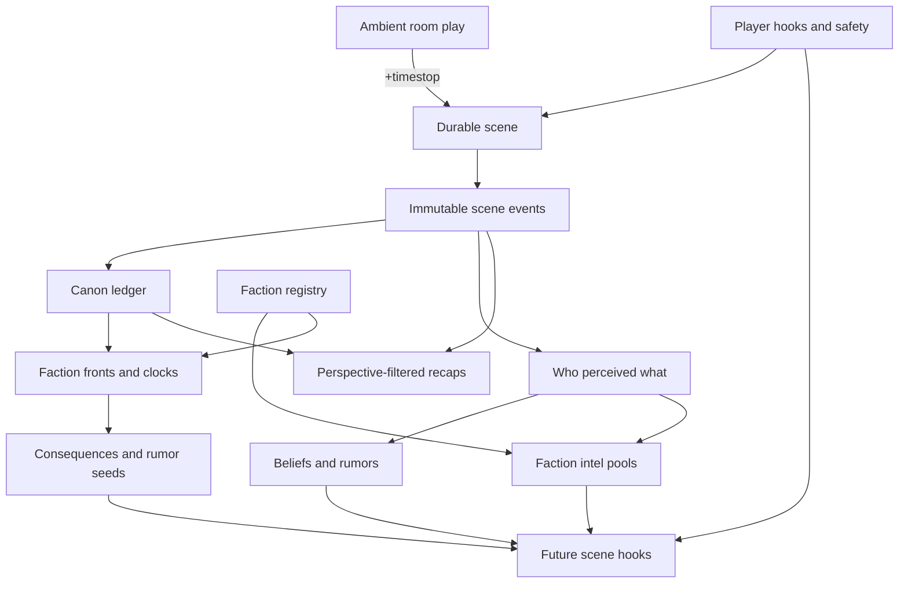

> **Revised 2026-09-01** after a full code review (eight-agent survey of the scene/event/persistence/NPC/zone/ruleset seams). Decisions marked **RATIFIED** are settled: the module store-read seam, chunked JSON documents over streams for authoritative logs, the two-level IC time model, and §3's faction system — rewritten from a sketch into the full registry/simulation design. The faction registry is the next build.

Your Timestop concept is the right center of gravity. I would define a scene as an explicit, durable envelope around play, while leaving ordinary room roleplay ambient and unrecorded unless someone deliberately opens a scene.

A Timestop is then:

> Promotion of ambient room play into an exclusive, recorded, ruleset-driven, turn-based scene.

That generalizes cleanly to freeform recorded scenes, Shadowrun initiative, chases, downtime, and eventually TacSim without making every conversation heavyweight.



## 1. First-class scenes and Timestop

You already have most of the mechanical substrate: `Scene`, scene membership, module ownership, ruleset state, map blobs, hooks, and per-scene ticks in [module.rs](</C:/Users/faeni/cc/rustmush/crates/mush-core/src/module.rs:160>) and [module.rs](</C:/Users/faeni/cc/rustmush/crates/mush-core/src/module.rs:1833>).

The important change is that current scenes are explicitly transient and IDs restart at zero on boot. Narrative scenes need durable identities.

### Scene identity

Use a stable sortable ID such as UUIDv7 or ULID:

```rust
pub struct SceneId(pub Ulid);
```

If you want to preserve compact runtime keys, split it into:

```rust
SceneId(Ulid)        // durable/public identity
RuntimeSceneId(u64)  // optional per-boot scheduler/index identity
```

Never reuse a durable scene ID after restart.

**Migration note (code review):** the durable/runtime split hides real re-keying work. Persisted scene keys embed the per-boot `u64` today — `ruleset_state_key = "scene:{id}:state"` ([world.rs](</C:/Users/faeni/cc/rustmush/crates/mush-core/src/world.rs:1014>)) and the map-blob key ([module.rs](</C:/Users/faeni/cc/rustmush/crates/mush-core/src/module.rs:2024>)) — and the whole `Ctx`/tick/hook API is keyed on `SceneId(u64)`. Durable scenes must key their persisted docs by the ULID (otherwise rehydrated scenes get fresh runtime ids whose keys no longer match their docs — the exact interleaving hazard the boot purge contract exists to prevent), and that purge contract ([module.rs](</C:/Users/faeni/cc/rustmush/crates/mush-core/src/module.rs:172>)) needs an exemption: closed durable scenes' logs outlive the scene and must never be swept as orphans.

### Generic scene record

```rust
struct SceneRecord {
    id: SceneId,
    revision: u64,
    title: String,

    kind: SceneKind,
    ruleset: Option<RulesetId>,
    owner_module: ModuleId,

    mode: SceneMode,
    status: SceneStatus,

    anchors: BTreeSet<ObjId>,
    participants: BTreeMap<ObjId, Participant>,
    observers: BTreeMap<ObjId, Observer>,

    facilitator: Option<ObjId>,
    privacy: ScenePrivacy,
    recording: RecordingPolicy,

    created_by: ObjId,
    created_at: Timestamp,
    ic_started_at: ClockStamp, // exact WorldIc generation + instant
    clock_generation: u64,
    turn: i64,                 // monotonic successful turn advances
    ic_round_seconds: Option<u32>,
    env_snapshot: Option<EnvSnapshot>,
    ended_at: Option<Timestamp>,
}
```

```rust
enum SceneMode {
    Freeform,
    TurnBased,
    Realtime,
    Downtime,
}

enum SceneStatus {
    Preparing,
    Active,
    Paused { reason: PauseReason },
    Resolving,
    Closed { outcome: SceneOutcome },
    Voided,
}
```

Keep ruleset-specific initiative and combat state in the existing ruleset-state seam rather than putting WoD concepts into `SceneRecord`.

`last_event_seq` deliberately does **not** live in `SceneRecord` — it gets its own tiny doc, otherwise every recorded pose rewrites the full participants/observers record (the scene-state pattern is already snapshot-per-change, [module.rs](</C:/Users/faeni/cc/rustmush/crates/mush-core/src/module.rs:1928>); don't double the amplification).

### Scene time — two levels (RATIFIED)

**Global IC clock.** Already built and already ratio-scaled: `GameClock { ic_ratio, epoch_offset }` with `ic = epoch_offset + now × ic_ratio` ([clock.rs](</C:/Users/faeni/cc/rustmush/crates/mush-core/src/clock.rs:44>)), configured from `mushd.toml [game]`. This is the classic WoD-MUSH convention — IC runs at a multiple of real time so nocturnal PCs can play during the RL day and long campaigns don't take literal months — and it stays a pure function of wall time, which scenes must not break for the rest of the game.

**Scene-local IC time.** A turn-based scene decouples from that clock the moment it begins. Rule: `event.ic_time = scene.ic_started_at + rounds_elapsed × ic_round_seconds`, where `ic_started_at` is captured from the global clock at `+timestop` and the ruleset supplies the round duration (3 IC seconds for a WoD combat turn; Shadowrun and TacSim declare their own). Freeform and downtime scenes just stamp the global clock per event. Consequences:

- A timestop played across three real days occupies seconds-to-minutes of IC time, while the global clock keeps running for everyone else. That is correct — the fiction is that the fight took thirty seconds.
- Canon ordering uses `(ic_time, recorded_at)`. Two scenes played concurrently in real time may interleave IC timestamps; when relative order matters, the explicit "scene X precedes scene Y" canon assertion is the tool, not clock forensics.
- Anything that reads the environment at resolution time (weather modifiers via `WeatherQuery`, time-of-day) must read the scene's `env_snapshot`, captured at scene start — the live world will have drifted days by the time a long timestop closes.
- Clock triggers keyed to IC deadlines ("players ignored this threat for three IC days") evaluate against the global clock only, never against time elapsed inside a paused scene.

### Boundary and membership

Locations and participants should be separate concepts.

- `anchors`: rooms, vehicles, Matrix hosts, astral locations, or map objects covered by the scene.
- `participants`: characters and NPCs entitled to act.
- `observers`: characters receiving scene output but not acting.
- `facilitator`: staff member or authorized Storyteller.
- An object may participate in at most one **exclusive** scene.
- Nonexclusive freeform or downtime associations may overlap.

For a traditional Timestop:

```text
mode       = TurnBased
exclusive  = true
anchors    = current room
participants = eligible occupants at activation
admission  = Closed or FacilitatorApproval
recording  = Full
```

The movement hook can enforce:

- Participants cannot leave except through a scene-resolved movement action.
- Outsiders cannot enter a closed anchor.
- Staff may add, remove, or observe.
- Multi-room pursuits expand or move the anchor set explicitly.
- Ending Timestop releases all movement restrictions atomically.

Your existing `MoveAttempt` hook is the natural enforcement point.

### Timestop lifecycle

```text
Ambient
  → Preparing
  → Active turn-based play
  ↔ Paused
  → Resolving
  → Closed
  → Ambient
```

Suggested behavior:

1. `+timestop` snapshots the room and creates `Preparing`.
2. Current PCs and relevant NPCs become proposed participants.
3. The ruleset calculates or requests initiative.
4. `+timestop/begin` freezes membership and begins round one.
5. Mechanics and IC activity produce ordered scene events.
6. `+timestop/pause` freezes turn advancement, not chat or safety commands.
7. `+timestop/end` commits the outcome and releases the boundary.

Do not automatically record the bar conversation preceding the Timestop. An explicit `+scene/start` can create a recorded freeform scene when players want that. Retroactively importing speech creates privacy and consent problems.

### Generic turn projection

Rulesets will have different initiative models, so core should not own detailed turn calculation. Require each scene driver to expose a common read-only projection:

```rust
struct TurnView {
    round_label: String,
    phase_label: Option<String>,
    active: Vec<ObjId>,
    upcoming: Vec<TurnSlot>,
    held: Vec<ObjId>,
    revision: u64,
    deadline: Option<Timestamp>,
}
```

The WoD driver can use ordinary initiative; Shadowrun can expose initiative passes; TacSim can use `Realtime` instead.

Every actionable turn gets a token:

```rust
TurnToken {
    scene: SceneId,
    revision: u64,
    round: u32,
    actor: ObjId,
    nonce: u64,
}
```

Tokens are resolved and attached by the driver, not presented by callers — a player cannot type a nonce. When a mechanical command dispatches, the driver binds the actor's current token to the in-flight action; NPC and LLM Storyteller completions carry the token they were issued when their turn began. Anything returning after the turn advances carries a stale token and is rejected.

**Enforcement lives in two places (code review),** because NPC actions never pass command dispatch — they re-enter as async completions applied in mush-npc's completion handler (routed by module name in [world_task.rs](</C:/Users/faeni/cc/rustmush/crates/mush-server/src/world_task.rs:2342>)). So: (1) the command path checks tokens in the driver's `command_policy`; (2) mush-npc's stimulus→turn pipeline must consult scene membership *before* starting an LLM turn — a member of an exclusive turn-based scene gets no free-running wakeups (mush-npc subscribes to `Said` and would otherwise keep triggering agent turns off recorded scene speech) and acts only when handed a token. The clean dependency shape is a small read-only "is this object in an exclusive scene?" query on core, since core already owns scene membership — mush-npc should not depend on the scenes module's typed state.

### Timestop command policy

While participating:

- OOC, help, safety, and scene-inspection commands always work.
- IC speech and poses may remain available and are recorded.
- Mechanical commands are routed through the scene driver.
- A mechanical action outside the actor’s turn is rejected or queued as an interrupt/held action.
- Ordinary NPC wakeups are suppressed.
- NPCs act only when given their scene turn token.
- `@teleport`, `home`, and ordinary exits are blocked unless staff override explicitly ends/removes them from the scene.

I would avoid automatic turn deadlines initially. Asynchronous MU* combat often pauses overnight. Add optional facilitator-configured deadlines later.

### Restart behavior

On clean or crash restart:

- Rehydrate active scene records.
- Restore ruleset scene state and event sequence.
- Restore the membership index.
- Resume every active Timestop as `Paused(ServerRestart)`.
- Require facilitator resume or a configured quorum.
- Never automatically advance a turn after restart.

That requires replacing the current “purge stale scene keys on boot” contract in [module.rs](</C:/Users/faeni/cc/rustmush/crates/mush-core/src/module.rs:172>): durable scenes are keyed by ULID (no per-boot id collision to defend against), their records rehydrate as `Paused(ServerRestart)`, and their event-log docs are permanent. The purge sweep continues to apply only to legacy transient scenes (tactics-style), which keep the old contract.

## 2. Beliefs, rumors, and provenance

The key design decision is to separate **truth**, **claims**, **evidence**, and **belief**.

### Data model

```rust
struct Claim {
    id: ClaimId,
    proposition: String,
    entities: Vec<ObjId>,
    tags: Vec<String>,
    truth: TruthStatus,
    created_from: Option<EventRef>,
    superseded_by: Option<ClaimId>,
}

enum TruthStatus {
    Unknown,
    CanonicallyTrue,
    CanonicallyFalse,
    Contested,
    Retconned,
}
```

```rust
struct Belief {
    holder: ObjId,
    claim: ClaimId,
    stance: BeliefStance,
    confidence: u8,
    salience: u8,
    evidence: Vec<EvidenceId>,
    learned_at: Timestamp,
    last_reinforced_at: Timestamp,
    disclosure: DisclosurePolicy,
}
```

```rust
struct Evidence {
    id: EvidenceId,
    claim: ClaimId,
    source_event: EventRef,
    immediate_source: Option<ObjId>,
    original_source: Option<ObjId>,
    channel: EvidenceChannel,
    transmission_depth: u16,
}
```

A rumor is not a special truth category. It is a claim supported by hearsay evidence.

A lie is also not simply “a false claim.” It is an assertion where the speaker deliberately asserted something inconsistent with their own belief. Intent should be explicit or remain unknown; the server should not infer deception merely because someone is mistaken.

### Acquisition flow

When Alice tells Bob that the Prince is dead:

1. The canonical scene event is “Alice asserted claim X.”
2. Bob receives evidence for X if he perceived the speech.
3. Bob’s belief policy decides whether this creates or reinforces belief.
4. Bob’s record says Alice was the immediate source.
5. If Bob tells Carol, Carol’s evidence points to Bob and preserves Alice as the reported origin.
6. Whether the Prince is actually dead remains a separate canon question.

This lets NPCs say:

- “Alice told me the Prince was dead.”
- “I’ve heard that, but I don’t believe it.”
- “Everyone in Elysium is repeating it.”
- “That contradicts what I personally witnessed.”

### LLM boundary

The NPC dialogue model should receive the NPC’s beliefs, not unrestricted canon.

Before retrieval:

1. Filter by holder.
2. Filter by visibility and current recipient/channel.
3. Rank by entities, relevance, confidence, salience, and recency.
4. Enforce a hard token budget.
5. Present evidence as untrusted records, never instructions.

Useful NPC tools would be:

```text
recall_claims(subjects, topic)
assert_claim(claim_id, audience)
record_evidence(claim_id, source_event)
change_confidence(claim_id, delta, reason)
```

Avoid arbitrary `Remember(String)` as the long-term representation.

### Claim minting and identity (code review)

Two problems the flow above glosses over, and the v1 answer to each:

**Who mints a claim?** Not an LLM watching every pose — per-utterance claim extraction puts model cost and latency on every line of every recorded scene, and it puts a model in the truth pipeline. In v1, claims are minted only by **typed sources**: mechanics that already know their own semantics (a power use, a death, a control change, an obligation), director/ST tools (an NPC deliberately asserting something), and staff commands. Ordinary IC speech is recorded as scene events but does not automatically become claims — organic PC-to-PC rumor rides the scene record and player memory, exactly as on any MUSH. LLM extraction of claims from transcripts can arrive later as a *proposal* pipeline (staff-reviewed), never as an automatic writer.

**When are two claims the same claim?** "The Prince is dead" uttered fifty ways must resolve to ONE `ClaimId`, or reinforcement, confidence, and "everyone in Elysium is repeating it" never fire. Free-text propositions cannot be reliably deduplicated, so: typed claims canonicalize on `(predicate, entities)` — `Dead(prince)`, `MemberOf(x, faction)`, `Controls(faction, region)` — and mint-if-absent; free-text propositions are permitted but second-class (no automatic merging, no contradiction detection). Add typed predicates gradually for the concepts that matter: affiliation, status, location, relationships, obligations, death, control. Do not begin by building a universal RDF ontology.

**Retention.** Beliefs and evidence are per-holder documents and grow with play. The working set (active holders' beliefs) stays RAM-resident and boot-loaded; cold evidence chains page in through the module store-read seam (see Engine prerequisites). Bound evidence per (holder, claim) — keep the first, the strongest, and the most recent; the full trail lives in the scene and canon records anyway.

Note that `Belief.holder` is deliberately not restricted to characters: **factions hold beliefs** — §3's intel pools are exactly a faction-scoped belief store — and eventually so do sensors' owners.

## 3. Factions — first-class, then fronts and clocks (REWRITTEN 2026-09-01)

The original sketch attached `Front.faction: FactionId` to a type this document never defined. Fixing that turned out to be the most consequential revision: factions are the central organizing concept in all three game lines — TacSim house/clan/merc unit; the Camarilla and several *independent* anarch gangs, with sub-factions inside each; Shadowrun crews, corps, and gangs — and the faction is also the natural generalization of the M12 NPC reporting `principal`. The system splits cleanly in two: a **registry** (cheap, zero scene/canon dependency — build first) and a **simulation** (fronts, clocks, contested territory — needs the canon ledger).

### 3.1 The faction record (registry)

```rust
struct Faction {
    id: FactionId,          // ULID, durable
    name: String,
    aliases: Vec<String>,
    charter: String,        // description + goals prose
    resources: BTreeMap<ResourceKind, i64>,
    principals: Vec<ObjId>, // NPC(s) who personify it: the Prince, the Johnson's boss
    ruleset_ext: serde_json::Value, // praxis/domain, turf income, contracts, TO&E
}
```

Resources are **typed pools, never one influence scalar** — WoD wants Influence-Police/Media/etc., herd, boon-credit; Shadowrun wants nuyen, gear, contacts; TacSim wants C-bills and dropship capacity. Core owns the pool mechanics (bounded, cause-stamped mutations — the same discipline as `ClockCause` below); rulesets declare the vocabulary and what fills or drains each pool. The litmus test for core vs. `ruleset_ext`: if a mechanic changes *how control or standing changes*, it's ruleset; if it changes *what is recorded*, it's core.

A faction must be able to exist and act with **zero PCs** — TacSim Great Houses and the offscreen Sabbat are factions before they are rosters.

### 3.2 Structure: typed edges, not tiers

Hard tiers (Sect > Clan > Coterie as schema) encode V20's shape into core and die on the first sub-gang, city court, or merc company. A bare parent pointer fails more subtly: Camarilla > Clan > coterie isn't containment — coteries are cross-clan, and Clan Toreador spans sects and cities ("Clan Toreador" the global lineage and "the Toreador of Chicago's court" are different objects with different politics). Model **faction nodes + typed directed edges**, small closed vocabulary:

- `ChapterOf` — Court of Chicago → Camarilla; planetary garrison → House Davion. Implies representation and *default* stance inheritance.
- `SubordinateTo` — lance → company; coterie sworn to the Prince.
- `ContractedTo` — merc unit → House; runner crew → Johnson's corp. Time-boxed, links to an obligation object (a TacSim contract *is* a typed faction-to-faction obligation).
- `FrontFor` — Setite temple → Followers of Set. **Secret by default**: the public-facing node is real and joinable; the edge is the secret. This one edge type buys cults, shell corps, and infiltration packs.

Rivalry, war, and alliance live in the **relationship matrix** (directed, asymmetric, public-stance vs. private-stance — the Camarilla is publicly neutral toward the Giovanni and privately hostile), not in the structure graph. Three guardrails against the classic pathologies:

1. **Membership is never transitive automatically.** "Is X Camarilla?" is a computed view per edge-type policy (`ChapterOf` derives sect standing; `ContractedTo` derives nothing); membership attaches to the most specific node. Storing transitive membership is how characters stay Camarilla after their coterie defects.
2. **Permissions never inherit downward implicitly.** The Prince's officers read a subordinate coterie's intel pool only via an explicit grant edge. Implicit inheritance is the #1 source of "staff faction sees everything" leaks.
3. **Acyclicity is enforced per structural edge type at write time.** Cycles are allowed only in the relationship matrix, where they mean something.

Multiple anarch gangs: N independent peer nodes, optionally each `ChapterOf` a thin "Anarch Movement" node when the chronicle wants movement-level clocks. The thinness of that node is the tell that the edge model is right — it holds almost no authority but can still own a front.

### 3.3 Membership: truth, visibility, and belief

Three things every historical MUSH faction system conflated, kept separate here:

```rust
struct Membership {
    character: ObjId,
    faction: FactionId,
    rank: RankId,                       // ruleset-defined ladder
    visibility: MembershipVisibility,   // Public | MembersKnow | OfficersKnow | Covert
    since: IcTimestamp,
}
```

1. **The membership fact** is engine ground truth and drives *authorization only*: intel-pool clearance, faction channel eligibility, treasury access, territory actions. Locks always check truth.
2. **The visibility policy** governs display surfaces. Even the roster-keepers' list is a belief set: the engine knows the Setite is not Toreador; the Toreador Primogen merely holds a well-evidenced claim.
3. **Membership claims** — "X is a member of F" is an ordinary §2 claim, acquired through evidence: seen at Elysium with the Primogen, wears the gang's colors, named in a stolen corp HR file. The infiltrator = covert true membership in F **plus** a canonically false membership claim for G that the character actively asserts and has manufactured evidence for. This is the epistemic engine's observer-dependent identity, applied to affiliation.

If membership were public-only, the design collapses in four places: the intel pool becomes pointless (everyone knows who reports to whom — the waterfront gang would simply *know* which lurker is the Prince's spy); NPC prompts leak ground-truth rosters (the bartender greets the infiltrator by real allegiance — membership fed to dialogue must pass the same belief filter as everything else); every display surface (`+finger`, channel member lists, territory readouts, recaps) becomes an OOC roster; and infiltration plots — a third of the WoD genre — are unrunnable. One balance rule: covert membership must **shed evidence** (meetings are witnessable events; intel filings leave provenance trails) so discovery is expensive but mechanically possible. The clue-redundancy principle applies to memberships too.

**Standing within a faction is three quantities, never one number:**

- **Office/rank** — structural authorization (clearance tier, treasury, speaking for the faction in obligations, BT command authority). Set by canonical appointment events; can itself be covert (the secret Sheriff).
- **Public reputation** (WoD Status, SR street cred/notoriety, BT MRB rating) — conferred by named others, so store the **grants, not the sum**: `StatusGrant { grantor, grantee, faction_scope, reason, witnesses, canon_event, revoked_by }`; the displayed value is a fold over unrevoked grants. Payoffs: the Harpy NPC can cite *why* ("Acknowledged by Prince Marcus after the Sabbat raid"), revocation is an event with an angry grantor attached, status inflation is auditable, and reputation is observer-visible per epistemic rules — the neonate fresh off the boat has to learn it. Standing must attach to characters *or* member-factions (a merc *unit's* MRB rating).
- **Private regard** — what the faction's principal NPCs actually think (the idea-6 directed relationship values), fed by the intel pool and explicitly allowed to diverge from public reputation. Harpy-adored but Prince-distrusted is a core V20 situation, and the divergence generates hooks.

All three are asymmetric and faction-scoped; every change is a ledger event with provenance and rate limits. The LLM proposes standing changes through a bounded director tool; the engine validates grantor eligibility and applies — an NPC cannot hand out Status its rank doesn't entitle it to grant. Boons interlock here: on a V20 game, boon-credit *is* a standing currency; the boon registry should be queryable by the standing fold, not duplicated into it.

### 3.4 Intel pools — the faction as epistemic actor (generalizes M12)

The shipped M12 informant loop files intel to `principal: Option<ObjId>` — one character ([profile.rs](</C:/Users/faeni/cc/rustmush/crates/mush-npc/src/profile.rs:125>)). Generalize, don't replace:

```rust
enum Principal {
    Character(ObjId),   // the ghoul reports to its domitor — personal bonds stay personal
    Faction(FactionId), // the gang lookout reports to the gang
}
```

A faction intel pool is a **clearance-gated shared belief store**: NPC informants deposit provenance-tagged records; members pull via `+intel`, filtered by rank/clearance. The faction thereby *knows* things — and can be wrong, deceived, or slow, because its knowledge is whatever was reported, never canon. The Prince's NPC prompt draws on the Camarilla pool at his clearance, not on ground truth. This is the load-bearing novel piece: it is what turns moles, counterintelligence, and "who staffs your establishment" into real gameplay, and no historical +faction system had it. Chained reporting (ghoul → domitor → domitor's coterie) is just evidence transmission with depth, which §2 already models — a faction is an institutionalized evidence channel.

In the registry build, pools hold today's `IntelRecord`s (the M12 machinery, re-keyed by `Principal`); when §2 lands, records upgrade to claims-with-evidence and the pool becomes a true belief store.

### 3.5 Territory and control

```rust
struct ControlRecord {
    region: RegionRef,
    faction: FactionId,
    kind: ControlKind,      // DeJure | DeFacto | Covert | Economic
    strength: u8,
    contested_by: Vec<FactionId>,
    since: IcTimestamp,
    visibility: ControlVisibility, // the Nosferatu own the sewers; nobody knows
}
```

Two rules and one condition:

- **Control changes only via front/clock resolution or staff action** — never by fiat inside a scene, never by an LLM. The anarch waterfront seizure and a Davion planetary assault are structurally identical: a front opens, clocks advance from scene outcomes and scheduled ticks, completion emits the canon event ("waterfront control: Undertow, DeFacto"), rumor seeds, and hooks.
- **`ControlKind` is the story engine, not polish.** The waterfront scenario *is* de jure/de facto divergence — the Prince still claims the domain (DeJure, Camarilla) while the gang holds it (DeFacto, Undertow). A single owner field makes the interesting states — contested, layered, covert — unrepresentable and leaves the LLM nothing to color. Divergence between control kinds is itself a condition that advances clocks: unresolved splits generate pressure.
- **`RegionRef` must not be the room graph.** A Region is its own light object that *may* reference a zone (the existing ZMO machinery is the street-level implementation for free — zone membership, `Zone`-lock delegation for "faction officers administer faction territory," `zone_members_of` as the holdings query), a set of zones ("the waterfront district"), a map-blob area (BT planetary objectives, roomless), or **nothing at all**: "Media influence in Chicago" as a non-spatial region means WoD influence spheres reuse territory mechanics wholesale.

What stays ruleset-owned: *how* clocks advance (influence actions and praxis declarations vs. gang-war scenes and legwork vs. contract fulfillment and tactical-map victories), tick cadence (nights vs. campaign months — clocks carry `next_due`, so this is free), and what control *grants* (hunting rights and herd vs. turf income vs. factory output and supply lines) — grants are resource-pool faucets declared per ruleset.

### 3.6 Fronts and clocks (simulation)

Model a front as an active threat or opportunity; model clocks as deterministic progress.

```rust
struct Front {
    id: FrontId,
    faction: FactionId,
    title: String,
    scope: Scope,
    status: FrontStatus,
    clocks: Vec<ClockId>,
    involved_entities: BTreeSet<ObjId>,
}
```

```rust
struct Clock {
    id: ClockId,
    front: FrontId,
    title: String,
    segments: u8,
    filled: u8,
    visibility: ClockVisibility,
    triggers: Vec<ClockTrigger>,
    consequences: Vec<ClockConsequence>,
    next_due: Option<IcTimestamp>,
    revision: u64,
}
```

#### Advancement rules

A clock advances only from a typed cause:

```rust
enum ClockCause {
    CanonEvent(CanonEventId),
    SceneOutcome(SceneId),
    ScheduledTick(TimerId),
    StaffAction(ObjId),
}
```

Store the cause ID so retries cannot advance a clock twice.

Examples:

- A scene outcome damages Camarilla influence: `-1 influence`, rival clock `+1`.
- Players ignore a threat through three IC days: clock `+1`.
- An NPC successfully obtains evidence: investigation clock `+1`.
- Staff explicitly advances it for an offscreen development.

The LLM may classify or propose a clock consequence, but the module validates and applies it.

#### Pressure budget

Prevent the world simulation from becoming an infinite event generator:

- Each faction gets a limited number of offscreen actions per IC period.
- Only active fronts tick.
- A clock completion may produce one consequence bundle.
- Consequences create canon events and rumor seeds, not automatic scenes.
- Player-facing hooks are offered only when they match interested characters.

The existing coarse scheduler can drive periodic evaluation. Prefer event-driven advancement for most clocks and coarse ticks only for deadlines.

#### Hidden consequences

Faction activity should not automatically become player knowledge.

A completed clock can create:

1. A canonical event: the warehouse changed ownership.
2. Evidence opportunities: witnesses, news reports, Contacts, physical clues.
3. Rumor seeds available to eligible NPCs.
4. Potential scene hooks.

Canon changes immediately; beliefs change only through perception or communication.

### 3.7 Design tests (the graveyard of MUSH faction systems)

1. **No faction-head bottleneck.** Twenty years of WoD MUSHes died of Prince-shaped single points of failure; BT MUXes died of idle House leadership freezing the war. Test: delete every PC in the faction — the waterfront conflict must still advance, because the faction's motion lives in fronts/clocks driven by the engine and personified by NPC principals the LLM colors. PC officers hold bounded, delegated, revocable powers on top.
2. **Not decoration.** A roster plus a channel plus a `+finger` flag is not a faction system, and a staff-updated influence spreadsheet is not a simulation — that is how nearly every V:tM influence system died: no deterministic path from player action to territorial consequence, so staff updated it monthly until they stopped. The missing middle is exactly `ClockCause::SceneOutcome`. Protect it: every control/resource/standing mutation carries a cause id, and the pressure budget keeps the sim from spamming in the other direction.
3. **No leaking rosters, and no black-box secrecy either.** Two failure modes of one axis: public `+factions` output let players metagame the Setite instantly (so games stopped writing infiltration plots); total secrecy with no coded discovery path produced boundless paranoia and staff-fiat everything. §3.3 in full is the fix — truth for authorization, belief projection for every display surface, mechanical evidence trails so secrets are expensive but discoverable.
4. **Never code loyalty.** No locks that mechanically prevent acting against your own faction — attacking faction-mates and selling faction intel stay legal game actions that generate events and evidence. The engine's job is to make treachery *recorded and discoverable*, never impossible.

## 4. Player hooks and safety boundaries

Treat story hooks and safety settings as related but distinct.

### Character story hooks

```rust
struct StoryHook {
    id: HookId,
    character: ObjId,
    themes: BTreeSet<ThemeTag>,
    desire: HookDesire,
    intensity: u8,
    visibility: HookVisibility,
    status: HookStatus,
    expires_at: Option<IcTimestamp>,
}
```

Examples:

- Wants conflict with their sire.
- Interested in political intrigue.
- Looking for opportunities involving Contacts.
- Open to betrayal, but only with staff facilitation.
- Wants more investigative scenes.
- Hook resolved or temporarily paused.

The director or staff tooling can match faction developments against hooks. A hook invites opportunity; it never authorizes the system to dictate the character’s response.

### Safety profile

Store OOC safety data separately from character attributes and scripts:

```rust
struct SafetyProfile {
    account: AccountId,
    lines: BTreeSet<ContentTag>,
    veils: BTreeSet<ContentTag>,
    ask_first: BTreeSet<ContentTag>,
    preferred_intensity: BTreeMap<ContentTag, u8>,
}
```

Avoid requiring players to store explanations. The category and rule are sufficient; private prose about why something is a boundary should not enter prompts, logs, or character data.

A scene’s effective safety policy is the most restrictive combination of:

- Server policy.
- Chronicle policy.
- Participant profiles.
- Explicit scene overrides that only make the policy more restrictive.

The LLM receives the resulting operational constraints, not who requested them or why.

### Immediate scene safety commands

These must bypass initiative, cooldowns, flood control, and LLM processing:

```text
+scene/pause
+scene/checkin
+scene/veil <topic>
+scene/rewind
+scene/resume
+scene/escalate
```

`+scene/pause` should not reveal who invoked it unless that player chooses to identify themselves.

Define two rewind levels:

- **Uncommitted rewind:** cancel the current declaration before mechanical commit.
- **Committed rewind:** pause and append a retcon/compensating event. Do not silently erase persisted history or reverse arbitrary world mutations.

Safety operations belong in a small private operational audit, not the IC transcript.

## 5. Canon ledger and perspective recaps

Use two related records.

### Scene event log

Scene events record what occurred inside the scene:

```rust
struct SceneEvent {
    scene: SceneId,
    seq: u64,
    id: EventId,

    occurred_at: Timestamp,
    ic_time: IcTimestamp,

    actor: Option<ObjId>,
    kind: SceneEventKind,
    location: Option<ObjId>,
    targets: Vec<ObjId>,

    witnesses: BTreeSet<ObjId>,
    source: EventSource,
    causation: Option<EventId>,
    correlation: Option<u64>,

    payload: VersionedPayload,
}
```

Record semantic events, not rendered SSH/HTML output:

- Alice said a line.
- Bob declared an attack.
- The engine rolled five dice and produced two successes.
- Carol took aggravated damage.
- A door was destroyed.
- A participant joined or left.
- The facilitator paused or closed the scene.

Do not record command typos, ordinary error messages, LLM prompts, or transport formatting.

The `witnesses` set must be captured when the event happens. Never recalculate it later from current location or perception. And "witness" needs a definition, because two plausible ones disagree — *present-and-could-perceive* vs. *was-actually-delivered-output* (linkdead-but-present characters, whispers, language, conceal-verdict ordering all split them). Rule: **a witness is what the delivery layer decided.** The recorded set is the outcome of the same per-recipient perception gate the output fan-out already runs ([world_task.rs](</C:/Users/faeni/cc/rustmush/crates/mush-server/src/world_task.rs:2274>)), captured from that single code path — so beliefs can never contradict what a player's client actually printed. The M14 director already uses this pattern for power use — `WorldEvent::PowerUsed` carries a pre-resolved witness set ([module.rs](</C:/Users/faeni/cc/rustmush/crates/mush-core/src/module.rs:464>)), though that set is NPC-only and director-computed, not captured from the delivery gate; scene recording extends the pre-resolved-set idea to speech and movement while sourcing it from the fan-out itself. The semantic `WorldEvent` abstraction ([module.rs](</C:/Users/faeni/cc/rustmush/crates/mush-core/src/module.rs:400>)) is the starting point, but today it carries no ids, no scene correlation, and (outside `PowerUsed`) no witness sets — those get added for recorded scenes. For long runs of events with an unchanged audience, record witness *deltas* against the scene's membership snapshot rather than a full `BTreeSet<ObjId>` per pose.

### Canon event ledger

Canon events are the durable consequences selected from scene and world activity:

```rust
struct CanonEvent {
    id: CanonEventId,
    occurred_at: IcTimestamp,
    recorded_at: Timestamp,

    kind: CanonEventKind,
    entities: BTreeSet<ObjId>,
    scope: CanonScope,

    source_scene: Option<SceneId>,
    source_event: Option<EventId>,

    status: CanonStatus,
    supersedes: Option<CanonEventId>,
    payload: VersionedPayload,
}
```

Not every scene event becomes a world consequence.

Important distinction:

- “Alice said the Prince is dead” may be canonical as an utterance.
- “The Prince is dead” is not canonical unless separately established.
- A failed attack remains part of the scene history but may create no persistent canon consequence.
- Health loss, obligations, destroyed objects, faction changes, and discovered clues usually do.

Do not event-source the entire `World` in v1. Keep current object documents as the materialized state. The canon ledger is an immutable history and narrative dependency graph. Domain modules explicitly emit canon events alongside their ordinary state mutations.

### Transaction boundary and storage (RATIFIED: chunked docs, not streams)

A mechanical state mutation, its scene event, and any canon event must enter the same ack-gated write batch:

```text
apply damage
+ append SceneEvent   (chunk-doc rewrite)
+ append CanonEvent   (chunk-doc rewrite)
+ update the scene's seq doc
= one successful command transaction
```

**Storage ruling.** `ModuleWrite::StreamAppend` is mandatory-capped — `maxlen` is a required field ([module.rs](</C:/Users/faeni/cc/rustmush/crates/mush-core/src/module.rs:105>)), trimmed inside every `XADD` ([redis.rs](</C:/Users/faeni/cc/rustmush/crates/mush-store/src/redis.rs:544>)) — and raw streams have two disqualifying failure modes for an authoritative log: the store writer retries whole batches on ambiguous failure, so `XADD *` entries can be **duplicated**; and a deterministically failing batch is **dropped**, losing its appends permanently ([persist.rs](</C:/Users/faeni/cc/rustmush/crates/mush-server/src/persist.rs:174>)). Ledgers therefore use **chunked immutable JSON documents**: events buffer into the current chunk doc, keyed `log:{scene_ulid}:{chunk_seq}` (module keys may contain `:`), one whole-doc `JsonSet` per append. That is idempotent on retry (a re-sent batch rewrites the same doc to the same bytes), covered by the existing per-namespace migration machinery (which skips streams entirely), enumerated by the normal boot scan, and commits atomically in the same batch as the state mutation. Chunk size bounds the per-write amplification — seal a chunk at a few KB and open the next key. Do not use a history ring that may discard old events.

**Honesty about the boundary (code review).** Two caveats the driver design must own rather than assume away:

- A handler that mutates the world and then errors does **not** roll back the mutation — the deferred persistence queue truncates ([cmd.rs](</C:/Users/faeni/cc/rustmush/crates/mush-core/src/cmd.rs:851>)), but world state already applied still flushes with the step. The mutation+event pairing is a **per-driver invariant enforced by helper shape** — one call that applies the mutation *and* queues both docs, so a driver physically cannot do one without the other — plus testkit assertions, not an engine transaction.
- `gate_on_durable_ack` gates **output**, not state; RAM runs ahead of the store either way. For ledger-bearing commands, the deterministic-failure policy must be "surface loudly to staff and mark the scene damaged," never silent drop.

### Retcons

Retcons append; they do not rewrite.

```text
CanonEvent #42: warehouse destroyed
CanonRevision #71: supersedes #42; warehouse damaged but standing
Compensating mutations: restore room state
```

Derived beliefs, hooks, clocks, and recaps retain source IDs. A revision can therefore:

- Mark affected recaps stale.
- Lower confidence in beliefs derived from the old event.
- Recalculate an affected clock if policy allows.
- Show staff what downstream material requires review.

### Recaps

Authorization filtering happens before any LLM call.

Available views:

- **Personal:** events the character witnessed, plus their own beliefs.
- **Public scene:** events visible to all participants.
- **Facilitator:** complete scene, hidden rolls, and secret consequences.
- **Mechanical timeline:** deterministic, no LLM required.
- **Previously on:** selected canon events across several scenes.

Persist generated recaps as derived artifacts:

```rust
struct Recap {
    id: RecapId,
    perspective: RecapPerspective,
    source_events: Vec<EventId>,
    source_canon: Vec<CanonEventId>,
    generated_at: Timestamp,
    prompt_version: String,
    model: Option<String>,
    text: String,
    stale: bool,
}
```

A recap is never evidence or canon merely because a model wrote it.

## Suggested module/API shape

I would keep the generic scene substrate in core and put commands/policy in a `mush-scenes` module.

Add a registered driver seam:

```rust
trait SceneDriver: Send + Sync {
    fn kind(&self) -> &'static str;

    fn validate_start(
        &self,
        world: &World,
        draft: &SceneDraft,
    ) -> Result<(), RichText>;

    fn command_policy(
        &self,
        world: &World,
        scene: &SceneRecord,
        actor: ObjId,
        command: &ParsedArgs,
    ) -> SceneCommandPolicy;

    fn turn_view(
        &self,
        world: &World,
        scene: &SceneRecord,
    ) -> Option<TurnView>;

    fn on_scene_event(
        &self,
        ctx: &mut Ctx<'_>,
        scene: SceneId,
        event: &SceneEvent,
    );

    fn resolve_end(
        &self,
        ctx: &mut Ctx<'_>,
        scene: SceneId,
    ) -> Result<SceneOutcome, RichText>;
}
```

And transaction helpers:

```rust
ctx.record_scene_event(scene, event);  // core — the scene substrate owns the log
ctx.commit_canon_event(event);         // core or mush-scenes

// NOT core Ctx (code review) — cross-namespace writes go through the owning
// module's public API, per the codebase's own layering rule (module.rs:1713):
beliefs::reveal_claim(ctx, holder, claim, evidence);
factions::advance_clock(ctx, clock, cause);
```

All of these queue typed persistence operations and participate in normal command rollback/ack gating. Putting epistemic and faction vocabulary on core `Ctx` would contradict both the code's cross-namespace rule and this document's own "generic substrate in core, policy in modules."

## Engine prerequisites (RATIFIED 2026-09-01)

Four pieces of core work surfaced by the code review. The first three form their own milestone (the "ledger substrate") because everything below leans on them:

1. **Module store-read seam.** Modules touch the store exactly two ways today: boot (whole-namespace `module_json_list` into RAM, plus newest-N stream tails) and blind writes. There is no read path during play — `QueryHandler` sees only `&World`, and the async-completion seam carries only an `LlmService` handle. Claims, evidence chains, and recaps at scale need an async module→store read (request out, typed completion back in — the same shape as LLM re-entry), so the working set stays RAM-resident and cold history pages in on demand.
2. **Chunked-document append helpers** (see Transaction boundary): one small core API for "append to a sealed-chunk log," so every ledger — scene events, canon, status grants, intel — reuses a single idempotent, migration-covered pattern.
3. **Boundary-invariant test rig**: testkit assertions that a driver's mutation and its events land in the same batch, plus the decided loud-failure policy for dropped ledger batches.
4. **Scene-local IC time** (see Scene time): trivial once decided — `ic_started_at + rounds × ic_round_seconds` — but it must be decided before any event is stamped. The global `ic_ratio` clock already exists.

## Recommended implementation order (revised)

1. **Faction registry** (§3.1–3.4 plus §3.5's *records*, with intel pools on today's `IntelRecord`s): nodes, typed edges, membership + visibility + rank, resource pools, `Principal::Faction` on the shipped M12 machinery, faction-bound comsys channels, staff-set `ControlRecord`s. Zero scene/canon dependency; immediate payoff; scenes and canon get `FactionId` from day one instead of a retrofit.
2. **Ledger substrate** (prerequisites 1–3 above).
3. **Durable scene identity and records.** Rehydrate scenes paused after restart.
4. **Timestop driver.** Membership, movement gate, initiative projection, turn tokens with both enforcement points, NPC wakeup suppression, environment snapshot, scene-local clock.
5. **Immutable scene event log.** Mechanics-only timeline first, then IC speech/poses.
6. **Safety and scene controls.** Build these before an automated director.
7. **Canon event ledger and deterministic recaps.**
8. **Claims, evidence, beliefs, and rumor transmission** — including upgrading faction intel pools from raw records to claims-with-provenance, and membership claims.
9. **Faction simulation** (§3.5's contested dynamics + §3.6): fronts, clocks, territory contests, standing grants.
10. **LLM recaps and director tools** over the deterministic substrate.

The critical architectural principle is:

> Scenes record what occurred; canon records what became true; beliefs record what someone thinks is true; factions record who acts together, what they hold, and what they know; recaps are only views over those records.

That separation will keep Timestop mechanically reliable while giving the LLM systems rich narrative material without making model-generated prose authoritative.
